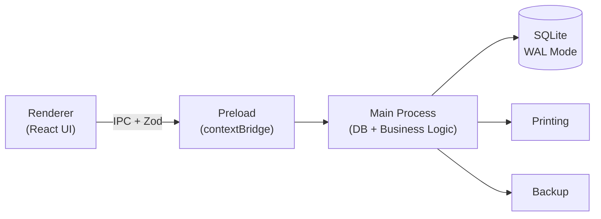
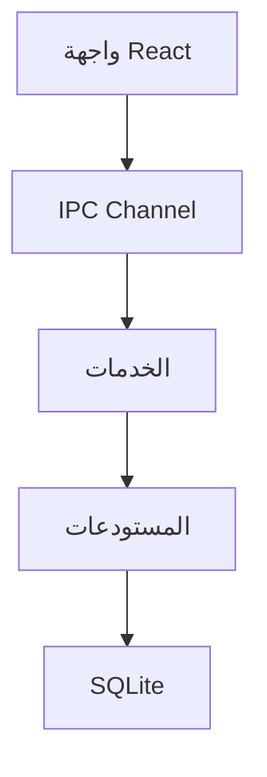

# 🏪 نظام بيع وجرد لمحل مستحضرات التجميل

## نظرة عامة على المشروع — الإصدار 1.0

---

## 1. الرؤية

برنامج **ويندوز ديسكتوب** يعمل بالكامل **أوفلاين** على جهاز المحل، يدير:
- البيع بالباركود (POS)
- المخزون وتواريخ الصلاحية (FEFO)
- المشتريات والموردين
- الخزنة والورديات
- التقارير والإحصائيات

---

## 2. المشاكل المستهدفة

| # | المشكلة | الحل |
|---|---------|------|
| 1 | الجرد بالورقة أو الإكسل وفروق المخزون | مخزون آلي بحركات مسجلة وجرد بالمسح |
| 2 | اكتشاف منتجات منتهية الصلاحية متأخرًا | تنبيهات مبكرة (30/60/90 يوم) و FEFO تلقائي |
| 3 | بطء البيع وأخطاء الأسعار | مسح باركود سريع وأسعار من قاعدة البيانات |
| 4 | صعوبة معرفة الربح الحقيقي | تكلفة بالدفعة وتقارير ربح تفصيلية |
| 5 | ضياع البيانات | WAL + نسخ احتياطي تلقائي + UPS |

---

## 3. الأهداف الأساسية

1. ✅ بيع سريع بالباركود — الفاتورة في ثوانٍ
2. ✅ مخزون دقيق — كل تغيير بسبب مسجل ومستخدم مسؤول
3. ✅ تنبيه مبكر للصلاحية والنواقص والراكد
4. ✅ ثبات عالٍ — لا ضياع بيانات حتى مع انقطاع الكهرباء
5. ✅ سهولة — كاشير جديد يتعلم في ساعة
6. ✅ قابلية التخصيص — يصلح لمحلات أخرى (white-label)

---

## 4. أولويات التصميم (بالترتيب)

```
صحة البيانات > السرعة > البساطة > الشكل
```

---

## 5. التقنية المختارة

| المكوّن | التقنية | السبب |
|---------|---------|-------|
| الإطار | **Electron** | ويندوز ديسكتوب + خبرة الفريق بالويب |
| الواجهة | **React + TypeScript** | مكونات قابلة لإعادة الاستخدام |
| قاعدة البيانات | **SQLite (better-sqlite3)** | أوفلاين، سريع، WAL mode |
| التحقق | **Zod** | تحقق من البيانات على IPC |
| الحزم | **electron-builder** | إنتاج setup.exe |
| التصميم | **CSS/Design System مخصص** | RTL عربي كامل |

> **⚠️ مهم:** لا خدمات خارجية ولا CDN ولا اتصال بالإنترنت أثناء التشغيل. الخطوط والأيقونات كلها **داخل التطبيق**.

---

## 6. المعمارية — العمليات الثلاث



### القواعد الأمنية:
- `contextIsolation: true`
- `nodeIntegration: false`
- كل طلب يمر عبر IPC ويُتحقق منه بـ Zod

---

## 7. هيكل المشروع

```
src/
  main/
    db/            # اتصال القاعدة، الإعدادات، migrations
    services/      # sales, inventory, purchases, returns, cash, reports, backup
    ipc/           # handlers + zod validation
    printing/      # receipt + label templates
  preload/         # contextBridge — واجهة آمنة
  renderer/
    features/      # pos, products, inventory, purchases, reports, settings
    components/    # مكونات UI مشتركة
    lib/           # أدوات مساعدة
  shared/          # types, zod schemas, money utils
tests/
  unit/
  integration/
  e2e/
```

---

## 8. الطبقات المعمارية



> **💡 نصيحة:** المنطق التجاري (حساب الخصم، FEFO، الضريبة) = دوال TypeScript نقية — قابلة للاختبار بدون واجهة.

---

## 9. الافتراضات (تحتاج تأكيد من العميل)

- [ ] جهاز واحد في المحل (كاشير واحد)
- [ ] ويندوز 10 أو 11
- [ ] سكانر باركود USB + طابعة إيصالات 80mm
- [ ] لا يحتاج فاتورة إلكترونية حاليًا

---

## 10. فهرس ملفات الخطة

| # | الملف | المحتوى |
|---|-------|---------|
| 00 | **هذا الملف** | نظرة عامة وهيكل المشروع |
| 01 | `01-قاعدة-البيانات.md` | تصميم الجداول والقيود و migrations |
| 02 | `02-المنتجات-والباركود.md` | إدارة المنتجات والـ variants والاستيراد |
| 03 | `03-نقطة-البيع-POS.md` | شاشة البيع والفوترة والطباعة |
| 04 | `04-المخزون-والصلاحية.md` | الدفعات والحركات والجرد والتنبيهات |
| 05 | `05-المشتريات-والموردين.md` | فواتير الشراء وحسابات الموردين |
| 06 | `06-المرتجعات-والعملاء.md` | المرتجعات والاستبدال والعملاء والآجل |
| 07 | `07-الخزنة-والورديات.md` | الورديات والمصروفات والخزنة |
| 08 | `08-التقارير-والإعدادات.md` | التقارير ولوحة التحكم والإعدادات |
| 09 | `09-الأمان-والنسخ-الاحتياطي.md` | المستخدمون والصلاحيات والنسخ الاحتياطي |
| 10 | `10-التصميم-والهوية-البصرية.md` | UX/UI والهوية والـ Design System |
| 11 | `11-خطة-التنفيذ-والتسليم.md` | المراحل والمخرجات والأجهزة |
