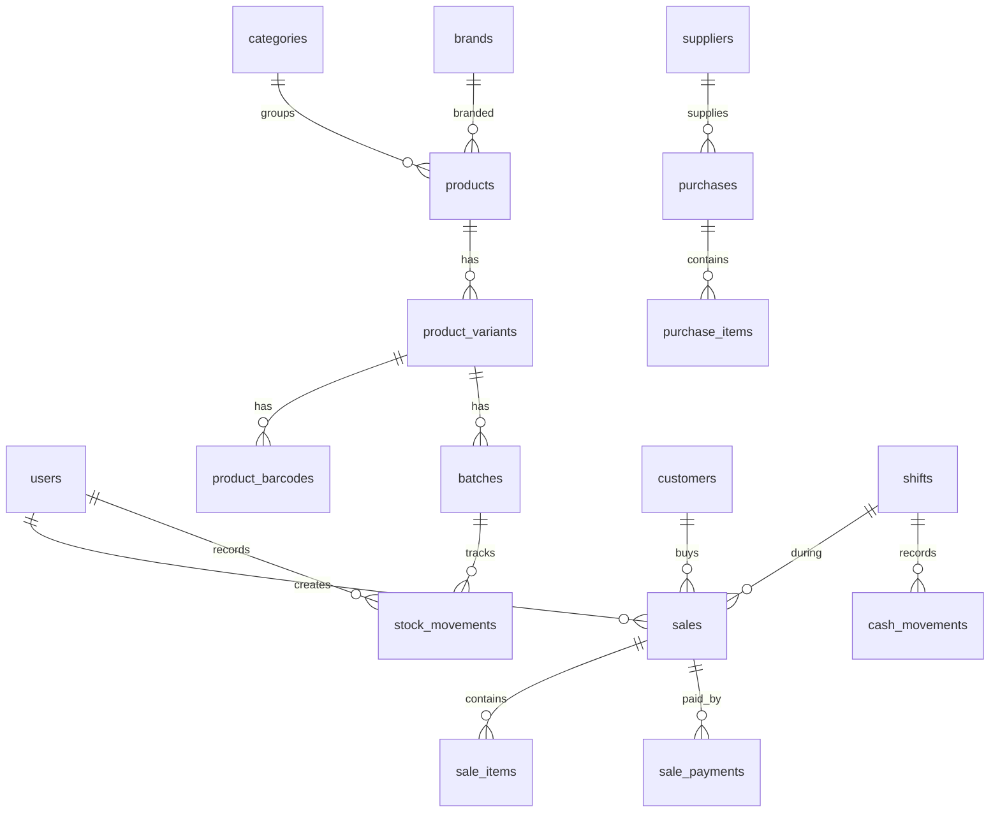

# 🗄️ الجزء 01 — قاعدة البيانات

## تصميم الجداول والقيود والـ Migrations

---

## 1. المبادئ الأساسية

| المبدأ | التفصيل |
|--------|---------|
| **المبالغ بالقروش** | `INTEGER` — مثال: 150.75 جنيه = `15075` — لتجنب أخطاء الكسور العشرية |
| **التواريخ ISO + UTC** | تُخزن بـ `YYYY-MM-DD HH:MM:SS` بتوقيت UTC، وتُعرض بتوقيت القاهرة |
| **id + uuid** | كل جدول رئيسي له `id` رقمي و `uuid` نصي فريد (تجهيزًا للمزامنة) |
| **لا حذف فعلي** | أرشفة `is_active = 0` أو إلغاء بسبب مسجل |
| **Snapshot** | سطر الفاتورة يحفظ لقطة من الاسم والسعر والتكلفة وقت البيع |
| **القيود على مستوى DB** | `PK`, `FK`, `UNIQUE`, `CHECK`, `NOT NULL` — الحماية في القاعدة نفسها |

---

## 2. إعدادات SQLite الأساسية (PRAGMAs)

```sql
PRAGMA journal_mode = WAL;       -- الأداء والأمان ضد انقطاع الكهرباء
PRAGMA foreign_keys = ON;         -- تفعيل المفاتيح الأجنبية
PRAGMA synchronous = FULL;        -- أقصى أمان للبيانات
PRAGMA busy_timeout = 5000;       -- 5 ثوانٍ انتظار عند القفل
```

> **⚠️ مهم:** هذه الإعدادات تُنفذ عند كل اتصال جديد بالقاعدة.

---

## 3. الجداول الرئيسية (مخطط ER)



---

## 4. الجداول الحرجة — التعريف

### 4.1 المنتجات والباركود

```sql
CREATE TABLE categories (
    id INTEGER PRIMARY KEY,
    uuid TEXT NOT NULL UNIQUE,
    name TEXT NOT NULL UNIQUE,
    is_active INTEGER NOT NULL DEFAULT 1,
    created_at TEXT NOT NULL
);

CREATE TABLE brands (
    id INTEGER PRIMARY KEY,
    uuid TEXT NOT NULL UNIQUE,
    name TEXT NOT NULL UNIQUE,
    is_active INTEGER NOT NULL DEFAULT 1,
    created_at TEXT NOT NULL
);

CREATE TABLE products (
    id INTEGER PRIMARY KEY,
    uuid TEXT NOT NULL UNIQUE,
    name_ar TEXT NOT NULL,
    name_en TEXT,
    category_id INTEGER REFERENCES categories(id),
    brand_id INTEGER REFERENCES brands(id),
    unit TEXT NOT NULL DEFAULT 'قطعة',
    image_path TEXT,
    is_active INTEGER NOT NULL DEFAULT 1,
    created_at TEXT NOT NULL,
    updated_at TEXT NOT NULL
);

CREATE TABLE product_variants (
    id INTEGER PRIMARY KEY,
    uuid TEXT NOT NULL UNIQUE,
    product_id INTEGER NOT NULL REFERENCES products(id),
    name TEXT,                       -- shade / size
    sku TEXT UNIQUE,
    sale_price INTEGER NOT NULL CHECK (sale_price >= 0),  -- بالقروش
    min_stock INTEGER NOT NULL DEFAULT 0,
    is_active INTEGER NOT NULL DEFAULT 1
);

CREATE TABLE product_barcodes (
    id INTEGER PRIMARY KEY,
    variant_id INTEGER NOT NULL REFERENCES product_variants(id),
    barcode TEXT NOT NULL UNIQUE,    -- فريد على مستوى قاعدة البيانات
    is_internal INTEGER NOT NULL DEFAULT 0
);
```

### 4.2 الدفعات والمخزون

```sql
CREATE TABLE batches (
    id INTEGER PRIMARY KEY,
    variant_id INTEGER NOT NULL REFERENCES product_variants(id),
    batch_no TEXT,
    expiry_date TEXT,                -- YYYY-MM-DD أو NULL
    unit_cost INTEGER NOT NULL CHECK (unit_cost >= 0),  -- بالقروش
    qty_remaining INTEGER NOT NULL CHECK (qty_remaining >= 0),
    received_at TEXT NOT NULL
);

CREATE TABLE stock_movements (
    id INTEGER PRIMARY KEY,
    batch_id INTEGER NOT NULL REFERENCES batches(id),
    type TEXT NOT NULL CHECK (type IN
        ('purchase','sale','sale_return','purchase_return',
         'adjust_in','adjust_out','expired','tester')),
    qty INTEGER NOT NULL CHECK (qty <> 0),  -- + دخول, - خروج
    ref_type TEXT,
    ref_id INTEGER,
    user_id INTEGER NOT NULL REFERENCES users(id),
    note TEXT,
    created_at TEXT NOT NULL
);
```

### 4.3 Triggers المخزون (القلب النابض)

```sql
-- تحديث كمية الدفعة تلقائيًا عند تسجيل حركة
CREATE TRIGGER trg_movement_apply AFTER INSERT ON stock_movements
BEGIN
    UPDATE batches SET qty_remaining = qty_remaining + NEW.qty
    WHERE id = NEW.batch_id;
    -- إذا أصبحت الكمية سالبة: CHECK constraint يفشل = ROLLBACK كامل
END;

-- المخزون append-only: لا تعديل ولا حذف
CREATE TRIGGER trg_movement_no_update BEFORE UPDATE ON stock_movements
BEGIN SELECT RAISE(ABORT, 'stock_movements is append-only'); END;

CREATE TRIGGER trg_movement_no_delete BEFORE DELETE ON stock_movements
BEGIN SELECT RAISE(ABORT, 'stock_movements is append-only'); END;
```

### 4.4 الفواتير

```sql
CREATE TABLE sales (
    id INTEGER PRIMARY KEY,
    uuid TEXT NOT NULL UNIQUE,
    seq_no INTEGER NOT NULL UNIQUE,     -- ترقيم بلا فجوات
    user_id INTEGER NOT NULL REFERENCES users(id),
    shift_id INTEGER NOT NULL REFERENCES shifts(id),
    customer_id INTEGER REFERENCES customers(id),
    subtotal INTEGER NOT NULL,           -- بالقروش
    discount INTEGER NOT NULL DEFAULT 0,
    tax INTEGER NOT NULL DEFAULT 0,
    total INTEGER NOT NULL,
    status TEXT NOT NULL DEFAULT 'completed'
        CHECK (status IN ('completed','voided','held')),
    void_reason TEXT,
    created_at TEXT NOT NULL
);

CREATE TABLE sale_items (
    id INTEGER PRIMARY KEY,
    sale_id INTEGER NOT NULL REFERENCES sales(id),
    variant_id INTEGER NOT NULL REFERENCES product_variants(id),
    batch_id INTEGER NOT NULL REFERENCES batches(id),
    qty INTEGER NOT NULL CHECK (qty > 0),
    unit_price INTEGER NOT NULL,        -- snapshot وقت البيع
    unit_cost INTEGER NOT NULL,         -- snapshot التكلفة
    item_name TEXT NOT NULL,            -- snapshot الاسم
    discount INTEGER NOT NULL DEFAULT 0,
    line_total INTEGER NOT NULL
);

CREATE TABLE sale_payments (
    id INTEGER PRIMARY KEY,
    sale_id INTEGER NOT NULL REFERENCES sales(id),
    method TEXT NOT NULL CHECK (method IN
        ('cash','card','wallet','credit')),
    amount INTEGER NOT NULL CHECK (amount > 0)
);

-- العداد التسلسلي
CREATE TABLE counters (
    name TEXT PRIMARY KEY,
    value INTEGER NOT NULL DEFAULT 0
);
INSERT INTO counters (name, value) VALUES ('sale_seq', 0);
```

### 4.5 المستخدمون والورديات

```sql
CREATE TABLE users (
    id INTEGER PRIMARY KEY,
    uuid TEXT NOT NULL UNIQUE,
    username TEXT NOT NULL UNIQUE,
    display_name TEXT NOT NULL,
    password_hash TEXT NOT NULL,
    role TEXT NOT NULL CHECK (role IN ('owner','manager','cashier')),
    is_active INTEGER NOT NULL DEFAULT 1,
    created_at TEXT NOT NULL
);

CREATE TABLE shifts (
    id INTEGER PRIMARY KEY,
    uuid TEXT NOT NULL UNIQUE,
    user_id INTEGER NOT NULL REFERENCES users(id),
    opening_balance INTEGER NOT NULL,
    closing_balance INTEGER,
    expected_balance INTEGER,
    difference INTEGER,
    status TEXT NOT NULL DEFAULT 'open'
        CHECK (status IN ('open','closed')),
    opened_at TEXT NOT NULL,
    closed_at TEXT
);

CREATE TABLE cash_movements (
    id INTEGER PRIMARY KEY,
    shift_id INTEGER NOT NULL REFERENCES shifts(id),
    type TEXT NOT NULL CHECK (type IN
        ('sale','refund','expense','deposit','withdrawal')),
    amount INTEGER NOT NULL,
    ref_type TEXT,
    ref_id INTEGER,
    note TEXT,
    created_at TEXT NOT NULL
);

CREATE TABLE expenses (
    id INTEGER PRIMARY KEY,
    uuid TEXT NOT NULL UNIQUE,
    shift_id INTEGER NOT NULL REFERENCES shifts(id),
    category TEXT NOT NULL,
    amount INTEGER NOT NULL CHECK (amount > 0),
    note TEXT,
    user_id INTEGER NOT NULL REFERENCES users(id),
    created_at TEXT NOT NULL
);
```

### 4.6 الموردين والمشتريات

```sql
CREATE TABLE suppliers (
    id INTEGER PRIMARY KEY,
    uuid TEXT NOT NULL UNIQUE,
    name TEXT NOT NULL,
    phone TEXT,
    address TEXT,
    balance INTEGER NOT NULL DEFAULT 0,  -- رصيد المورد بالقروش
    is_active INTEGER NOT NULL DEFAULT 1,
    created_at TEXT NOT NULL
);

CREATE TABLE purchases (
    id INTEGER PRIMARY KEY,
    uuid TEXT NOT NULL UNIQUE,
    supplier_id INTEGER NOT NULL REFERENCES suppliers(id),
    total INTEGER NOT NULL,
    paid INTEGER NOT NULL DEFAULT 0,
    payment_method TEXT,
    user_id INTEGER NOT NULL REFERENCES users(id),
    note TEXT,
    created_at TEXT NOT NULL
);

CREATE TABLE purchase_items (
    id INTEGER PRIMARY KEY,
    purchase_id INTEGER NOT NULL REFERENCES purchases(id),
    variant_id INTEGER NOT NULL REFERENCES product_variants(id),
    batch_id INTEGER NOT NULL REFERENCES batches(id),
    qty INTEGER NOT NULL CHECK (qty > 0),
    unit_cost INTEGER NOT NULL,
    expiry_date TEXT,
    suggested_price INTEGER
);
```

### 4.7 العملاء والمرتجعات

```sql
CREATE TABLE customers (
    id INTEGER PRIMARY KEY,
    uuid TEXT NOT NULL UNIQUE,
    name TEXT NOT NULL,
    phone TEXT,
    credit_limit INTEGER NOT NULL DEFAULT 0,
    balance INTEGER NOT NULL DEFAULT 0,  -- رصيد مدين بالقروش
    is_active INTEGER NOT NULL DEFAULT 1,
    created_at TEXT NOT NULL
);

CREATE TABLE returns (
    id INTEGER PRIMARY KEY,
    uuid TEXT NOT NULL UNIQUE,
    sale_id INTEGER NOT NULL REFERENCES sales(id),
    user_id INTEGER NOT NULL REFERENCES users(id),
    total_refund INTEGER NOT NULL,
    refund_method TEXT NOT NULL CHECK (refund_method IN
        ('cash','credit','exchange')),
    reason TEXT,
    created_at TEXT NOT NULL
);

CREATE TABLE return_items (
    id INTEGER PRIMARY KEY,
    return_id INTEGER NOT NULL REFERENCES returns(id),
    sale_item_id INTEGER NOT NULL REFERENCES sale_items(id),
    variant_id INTEGER NOT NULL REFERENCES product_variants(id),
    qty INTEGER NOT NULL CHECK (qty > 0),
    condition TEXT NOT NULL CHECK (condition IN ('good','damaged')),
    -- good = يعود للمخزون, damaged = هالك
    batch_id INTEGER REFERENCES batches(id)
);
```

### 4.8 سجل العمليات والإعدادات

```sql
CREATE TABLE audit_log (
    id INTEGER PRIMARY KEY,
    user_id INTEGER NOT NULL REFERENCES users(id),
    action TEXT NOT NULL,
    entity_type TEXT NOT NULL,
    entity_id INTEGER,
    details TEXT,          -- JSON
    created_at TEXT NOT NULL
);

CREATE TABLE settings (
    key TEXT PRIMARY KEY,
    value TEXT NOT NULL,
    updated_at TEXT NOT NULL
);
```

---

## 5. قواعد النزاهة (Integrity Rules)

| # | القاعدة | التطبيق |
|---|---------|---------|
| 1 | لا تقل كمية الدفعة عن صفر | `CHECK (qty_remaining >= 0)` على batches |
| 2 | حركات المخزون append-only | Triggers تمنع UPDATE و DELETE |
| 3 | الفاتورة المكتملة لا تُعدل | Trigger يمنع التعديل بعد الحفظ |
| 4 | رقم الفاتورة بلا فجوات | جدول counters + transaction واحد |
| 5 | مجموع المدفوعات = صافي الفاتورة | تحقق في Service + اختبارات |
| 6 | لا حذف لمنتج/مورد/عميل له حركات | FK constraints + منطق الأرشفة |
| 7 | الباركود فريد عالميًا | `UNIQUE` على product_barcodes.barcode |

---

## 6. استراتيجية الـ Migrations

```
src/main/db/migrations/
  001_initial_schema.sql
  002_add_supplier_notes.sql
  003_...
```

### القواعد:
1. كل migration ملف SQL مرقم ولا يُعدل بعد النشر
2. جدول `schema_version` يتتبع آخر migration مطبق
3. عند بدء التطبيق: تُنفذ كل الـ migrations الجديدة بالترتيب
4. كل migration داخل transaction واحد
5. لا يُحذف عمود أو جدول فيه بيانات — نضيف فقط

```sql
CREATE TABLE schema_version (
    version INTEGER PRIMARY KEY,
    applied_at TEXT NOT NULL
);
```

---

## 7. أدوات المبالغ (Money Utils)

```typescript
// src/shared/money.ts

/** تحويل من جنيه إلى قروش */
export function toPiasters(pounds: number): number {
    return Math.round(pounds * 100);
}

/** تحويل من قروش إلى جنيه */
export function toPounds(piasters: number): number {
    return piasters / 100;
}

/** تنسيق المبلغ للعرض */
export function formatMoney(piasters: number): string {
    return (piasters / 100).toFixed(2) + ' ج.م';
}
```
