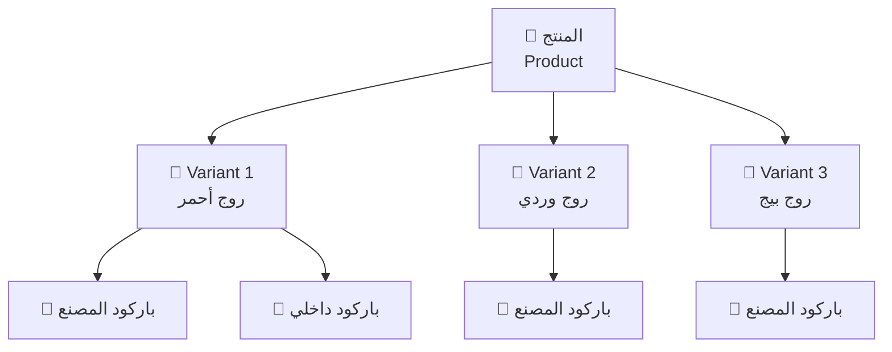
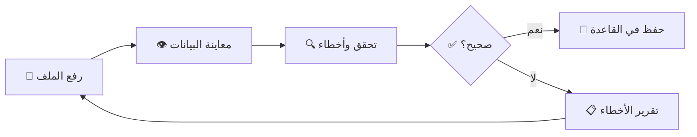

# 📦 الجزء 02 — المنتجات والباركود

## إدارة المنتجات والـ Variants والاستيراد

---

## 1. الهيكل الثلاثي



### العلاقة:
- **المنتج** = الصنف الأساسي (روج لوريال X)
- **Variant** = تنويع (درجة لون / حجم / عبوة) — لكل variant سعر بيع وباركود وSKU
- **باركود** = يمكن أن يكون أكثر من واحد لنفس الـ variant

---

## 2. بيانات المنتج

| الحقل | النوع | ملاحظات |
|-------|-------|---------|
| الاسم بالعربي | نص (مطلوب) | مثال: "روج لوريال باريس" |
| الاسم بالإنجليزي | نص (اختياري) | للبحث الإضافي |
| الماركة | قائمة | Loreal, Maybelline, ... |
| القسم | قائمة | مكياج، عناية بالبشرة، عطور، ... |
| الوحدة | نص | قطعة (افتراضي) |
| صورة | ملف (اختياري) | تُخزن محليًا |
| حد أدنى للمخزون | رقم | للتنبيه عند النقص |
| الحالة | نشط / مؤرشف | الأرشفة بدلاً من الحذف |

---

## 3. بيانات الـ Variant

| الحقل | النوع | ملاحظات |
|-------|-------|---------|
| الاسم | نص | "أحمر 305" — يُعرض بجانب اسم المنتج |
| SKU | نص فريد | كود داخلي |
| سعر البيع | رقم (قروش) | مطلوب — `CHECK >= 0` |
| حد أدنى | رقم | يرث من المنتج أو مخصص |

---

## 4. نظام الباركود

### 4.1 أنواع الباركود

| النوع | الوصف | العلم |
|-------|-------|-------|
| **باركود المصنع** | مطبوع على المنتج من المورد | `is_internal = 0` |
| **باركود داخلي** | يُولّده النظام للمنتجات بدون باركود | `is_internal = 1` |

### 4.2 توليد الباركود الداخلي

```
الصيغة: EAN-13
البادئة: 200 (نطاق الاستخدام الداخلي)
الهيكل: 200 + XXXXXXXXX + Check Digit
```

```typescript
// src/shared/barcode.ts

const INTERNAL_PREFIX = '200';

export function generateInternalBarcode(sequenceNumber: number): string {
    const body = INTERNAL_PREFIX + 
        String(sequenceNumber).padStart(9, '0');
    const checkDigit = calculateEAN13CheckDigit(body);
    return body + checkDigit;
}

function calculateEAN13CheckDigit(digits12: string): string {
    let sum = 0;
    for (let i = 0; i < 12; i++) {
        const digit = parseInt(digits12[i]);
        sum += i % 2 === 0 ? digit : digit * 3;
    }
    return String((10 - (sum % 10)) % 10);
}
```

### 4.3 القواعد الأساسية:
- ✅ الباركود **فريد** على مستوى كل قاعدة البيانات
- ✅ يمكن ربط أكثر من باركود بنفس الـ variant
- ✅ لا يُحذف باركود ظهر في فواتير سابقة
- ✅ منع التكرار: `UNIQUE` constraint

---

## 5. استيراد من Excel / CSV

### 5.1 المسار:



### 5.2 الأعمدة المتوقعة في الملف:

| العمود | مطلوب | ملاحظات |
|--------|-------|---------|
| الاسم بالعربي | ✅ | |
| الاسم بالإنجليزي | ❌ | |
| الماركة | ❌ | يُنشأ تلقائيًا إن لم يكن موجودًا |
| القسم | ❌ | يُنشأ تلقائيًا إن لم يكن موجودًا |
| الـ Variant | ❌ | افتراضي: variant واحد |
| الباركود | ❌ | |
| سعر البيع | ✅ | |
| سعر الشراء | ❌ | |
| الكمية | ❌ | |

### 5.3 أنواع الأخطاء المكتشفة:

| الخطأ | الوصف |
|-------|-------|
| 🔴 باركود مكرر | باركود موجود مسبقًا في القاعدة |
| 🔴 سعر ناقص | سعر البيع فارغ أو صفر |
| 🟡 قسم غير معروف | يُقترح إنشاؤه تلقائيًا |
| 🟡 ماركة غير معروفة | يُقترح إنشاؤها تلقائيًا |
| 🔴 اسم فارغ | الاسم بالعربي مطلوب |

---

## 6. تحديث بالجملة (Bulk Update)

### العمليات المدعومة:
- ✅ تحديث سعر البيع لعدة منتجات (نسبة أو مبلغ)
- ✅ تغيير القسم لمجموعة منتجات
- ✅ تغيير الماركة لمجموعة منتجات
- ✅ أرشفة مجموعة منتجات

### القيود:
- كل تحديث يُسجل في `audit_log`
- لا يُحذف منتج ظهر في فواتير — أرشفة فقط

---

## 7. البحث

### حقول البحث:
- الاسم بالعربي أو الإنجليزي
- الماركة
- الباركود أو جزء منه
- القسم
- SKU

### الأداء:
```sql
-- فهارس البحث
CREATE INDEX idx_products_name_ar ON products(name_ar);
CREATE INDEX idx_products_name_en ON products(name_en);
CREATE INDEX idx_product_barcodes_barcode ON product_barcodes(barcode);
CREATE INDEX idx_product_variants_sku ON product_variants(sku);
```

---

## 8. طباعة الملصقات

### المواصفات:
- حجم الملصق قابل للضبط من الإعدادات
- اختيار منتجات متعددة وتحديد عدد النسخ لكل منتج
- المعلومات على الملصق:
  - الاسم
  - الباركود (صورة + رقم)
  - السعر
  - تاريخ الصلاحية (اختياري)

### التقنية:
```typescript
// src/main/printing/label-template.ts
interface LabelConfig {
    width: number;       // mm
    height: number;      // mm
    showPrice: boolean;
    showExpiry: boolean;
    fontSize: number;
}
```

---

## 9. ملخص API الـ IPC

| القناة | الوظيفة |
|--------|---------|
| `products:list` | قائمة المنتجات مع فلاتر |
| `products:get` | تفاصيل منتج واحد |
| `products:create` | إنشاء منتج مع variants |
| `products:update` | تحديث بيانات المنتج |
| `products:archive` | أرشفة منتج |
| `products:import` | استيراد من Excel |
| `products:bulk-update` | تحديث بالجملة |
| `products:search` | بحث سريع |
| `barcodes:generate` | توليد باركود داخلي |
| `barcodes:print-labels` | طباعة ملصقات |
