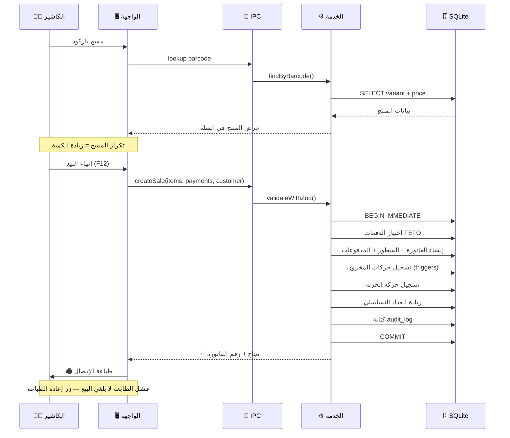
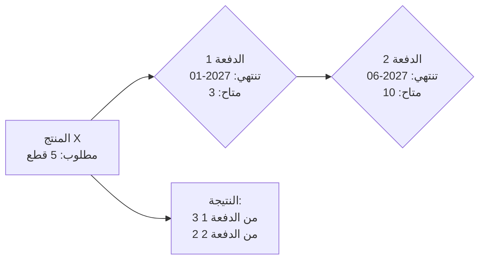

# 🛒 الجزء 03 — نقطة البيع (POS)

## شاشة البيع والفوترة والطباعة

---

## 1. المبادئ

| المبدأ | التفصيل |
|--------|---------|
| **السرعة أولًا** | العمل بالكيبورد والسكانر — بدون ماوس |
| **حقل الباركود دائمًا نشط** | يعود التركيز إليه تلقائيًا بعد أي عملية |
| **FEFO تلقائي** | يُخصم من الدفعة الأقرب انتهاءً أولًا |
| **لا تعديل بعد الحفظ** | التصحيح بمرتجع أو إلغاء بسبب مسجل |
| **Snapshot** | الأسعار والأسماء تُحفظ وقت البيع |

---

## 2. مسار عملية البيع الكامل



---

## 3. سلوكيات حقل الباركود

| الحالة | السلوك |
|--------|--------|
| مسح باركود موجود | يُضاف الصنف للسلة بكمية 1 |
| مسح باركود موجود مسبقًا في السلة | تُزاد الكمية +1 |
| مسح باركود غير موجود | 🔊 صوت تنبيه + نافذة "إضافة منتج جديد" |
| بحث يدوي (F2) | نافذة بحث بالاسم |
| بعد أي عملية | يعود التركيز تلقائيًا لحقل الباركود |

---

## 4. إدارة السلة

### 4.1 العمليات على السطر:
- ✏️ **تعديل الكمية** — مع التحقق من المخزون المتاح
- 🗑️ **حذف سطر** — من السلة فقط (قبل الحفظ)
- 💰 **خصم على السطر** — نسبة أو مبلغ

### 4.2 العمليات على الفاتورة:
- 💰 **خصم على الإجمالي** — نسبة أو مبلغ (ضمن حد الصلاحية)
- ⏸️ **تعليق الفاتورة (Hold)** — لخدمة عميلين بالتوازي
- ▶️ **استرجاع فاتورة معلقة** — واستكمالها

### 4.3 حدود الخصم:
```
الكاشير: خصم حتى X% (يحدده المالك)
فوق الحد: يحتاج PIN المدير
المدير/المالك: خصم بلا حد
```

---

## 5. طرق الدفع

| الطريقة | الوصف |
|---------|-------|
| 💵 **نقدي** | الباقي يُحسب تلقائيًا |
| 💳 **بطاقة** | لا يُحسب باقي |
| 📱 **محفظة إلكترونية** | Vodafone Cash, Instapay, ... |
| 📋 **آجل** | يُسجل على حساب العميل |
| ✂️ **دفع مجزأ** | أكثر من طريقة في فاتورة واحدة |

### قاعدة ذهبية:
```
مجموع المدفوعات = صافي الفاتورة
لا يُقبل مبلغ أقل ولا أكثر (إلا النقدي = الباقي)
```

---

## 6. سلوك المخزون

### 6.1 نظام FEFO:



### 6.2 حالات المخزون:

| الحالة | السلوك (قابل للضبط من الإعدادات) |
|--------|----------------------------------|
| مخزون صفر | **منع** البيع (افتراضي) أو **تحذير** فقط |
| دفعة منتهية الصلاحية | **منع** البيع نهائيًا |
| دفعة قريبة الانتهاء | **تحذير** مع السماح بالبيع |

---

## 7. الفاتورة بعد الحفظ

### 7.1 قواعد ثبات الفاتورة:
- ❌ لا تُعدل
- ❌ لا تُحذف
- ✅ التصحيح بمرتجع (مع ربط بالفاتورة الأصلية)
- ✅ الإلغاء بسبب مسجل ومستخدم مسؤول

### 7.2 الترقيم التسلسلي:

```typescript
// داخل transaction واحد
const seq = db.prepare(
    'UPDATE counters SET value = value + 1 WHERE name = ? RETURNING value'
).get('sale_seq');
// seq.value = الرقم الجديد — بلا فجوات
```

---

## 8. طباعة الإيصال

### 8.1 إيصال 80mm (حراري):

```
╔══════════════════════════════════╗
║        [لوجو المحل]             ║
║       اسم المحل                 ║
║       العنوان                   ║
║       التليفون                  ║
╠══════════════════════════════════╣
║  فاتورة رقم: 00152              ║
║  التاريخ: 2026-10-11 14:30      ║
║  الكاشير: أحمد                  ║
╠══════════════════════════════════╣
║  الصنف        الكمية   السعر    ║
║  ─────────    ──────   ──────   ║
║  روج لوريال      2     120.00   ║
║  كريم نيفيا      1      85.50   ║
║  ماسكارا         1      95.00   ║
╠══════════════════════════════════╣
║  الإجمالي:           420.50     ║
║  الخصم:              -20.00     ║
║  الصافي:             400.50     ║
║  نقدي:               500.00     ║
║  الباقي:              99.50     ║
╠══════════════════════════════════╣
║       شكرًا لزيارتكم            ║
║    [رسالة من الإعدادات]          ║
╚══════════════════════════════════╝
```

### 8.2 خيارات الطباعة:
- 🖨️ **طباعة تلقائية** بعد كل بيع
- 🔄 **إعادة الطباعة** من سجل الفواتير
- 📄 **طباعة A4** (اختيارية)
- ❌ **فشل الطباعة لا يلغي البيع**

---

## 9. اختصارات الكيبورد

| الاختصار | الوظيفة |
|----------|---------|
| `F2` | بحث يدوي بالاسم |
| `F3` | تعليق الفاتورة (Hold) |
| `F4` | استرجاع فاتورة معلقة |
| `F5` | خصم على الفاتورة |
| `F8` | تعديل كمية السطر المحدد |
| `Delete` | حذف السطر المحدد |
| `F12` | إنهاء البيع والدفع |
| `Esc` | إلغاء / إغلاق النافذة |
| `↑ ↓` | التنقل بين أسطر السلة |

---

## 10. ملخص API الـ IPC

| القناة | الوظيفة |
|--------|---------|
| `pos:lookup-barcode` | البحث عن منتج بالباركود |
| `pos:search-products` | بحث يدوي بالاسم |
| `pos:create-sale` | إنشاء فاتورة بيع كاملة |
| `pos:hold-sale` | تعليق فاتورة |
| `pos:resume-sale` | استرجاع فاتورة معلقة |
| `pos:void-sale` | إلغاء فاتورة بسبب |
| `pos:reprint` | إعادة طباعة إيصال |
| `pos:get-sale` | تفاصيل فاتورة |
| `pos:list-sales` | قائمة الفواتير |
