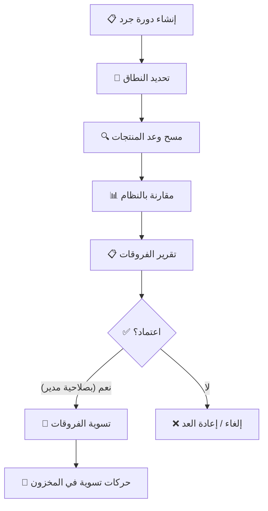

# 📊 الجزء 04 — المخزون والصلاحية

## الدفعات والحركات والجرد والتنبيهات

---

## 1. مفهوم الدفعات (Batches)

> كل استلام بضاعة يُنشئ **دفعة** جديدة. الدفعة هي وحدة تتبع المخزون.

### بيانات الدفعة:

| الحقل | النوع | الوصف |
|-------|-------|-------|
| `batch_no` | نص | رقم الدفعة (من المورد أو تلقائي) |
| `variant_id` | FK | المنتج/Variant المرتبط |
| `expiry_date` | تاريخ | تاريخ الصلاحية (أو NULL إن لم يكن هناك) |
| `unit_cost` | رقم (قروش) | تكلفة الوحدة — لحساب الربح بدقة |
| `qty_remaining` | رقم | الكمية المتبقية — لا تتغير إلا بحركة |
| `received_at` | تاريخ | تاريخ الاستلام |

### القاعدة الذهبية:
```
لا يتغير رصيد المخزون إلا بحركة مسجلة
لا يوجد تعديل مباشر على الرقم
```

---

## 2. أنواع حركات المخزون

| النوع | الاتجاه | الوصف | المرجع |
|-------|---------|-------|--------|
| `purchase` | ➕ دخول | استلام شراء | فاتورة الشراء |
| `sale` | ➖ خروج | بيع | فاتورة البيع |
| `sale_return` | ➕ دخول | مرتجع بيع (صالح) | المرتجع |
| `purchase_return` | ➖ خروج | مرتجع شراء | مرتجع الشراء |
| `adjust_in` | ➕ دخول | تسوية جرد بالزيادة | دورة الجرد |
| `adjust_out` | ➖ خروج | تسوية جرد بالنقص | دورة الجرد |
| `expired` | ➖ خروج | منتهي الصلاحية | — |
| `tester` | ➖ خروج | تستر / عينة | — |

### المنطق:
```sql
-- الحركة بقيمة موجبة = دخول، سالبة = خروج
-- الـ trigger يطبقها على الدفعة تلقائيًا
qty > 0  → إضافة للدفعة
qty < 0  → خصم من الدفعة
qty = 0  → مرفوض (CHECK constraint)
```

---

## 3. نظام FEFO (First Expiry, First Out)

### المنطق:

```typescript
// src/main/services/inventory.service.ts

interface BatchAllocation {
    batchId: number;
    qty: number;
    unitCost: number;
}

function allocateBatchesFEFO(
    variantId: number,
    requestedQty: number
): BatchAllocation[] {
    // 1. جلب الدفعات المتاحة مرتبة بالصلاحية الأقرب
    const batches = db.prepare(`
        SELECT id, qty_remaining, unit_cost, expiry_date
        FROM batches
        WHERE variant_id = ? AND qty_remaining > 0
        AND (expiry_date IS NULL OR expiry_date > date('now'))
        ORDER BY 
            CASE WHEN expiry_date IS NULL THEN 1 ELSE 0 END,
            expiry_date ASC
    `).all(variantId);

    // 2. توزيع الكمية على الدفعات
    const allocations: BatchAllocation[] = [];
    let remaining = requestedQty;

    for (const batch of batches) {
        if (remaining <= 0) break;
        const take = Math.min(remaining, batch.qty_remaining);
        allocations.push({
            batchId: batch.id,
            qty: take,
            unitCost: batch.unit_cost
        });
        remaining -= take;
    }

    // 3. إذا لم تكفِ الدفعات = خطأ
    if (remaining > 0) {
        throw new Error('الكمية المطلوبة غير متوفرة في المخزون');
    }

    return allocations;
}
```

---

## 4. نظام الجرد (Stocktaking)

### 4.1 مسار الجرد:



### 4.2 نطاق الجرد:

| النطاق | الوصف |
|--------|-------|
| كل المحل | جرد شامل |
| قسم معين | مثال: قسم المكياج فقط |
| ماركة معينة | مثال: منتجات لوريال فقط |
| منتجات محددة | اختيار يدوي |

### 4.3 بيانات دورة الجرد:

```sql
CREATE TABLE stock_counts (
    id INTEGER PRIMARY KEY,
    uuid TEXT NOT NULL UNIQUE,
    scope TEXT NOT NULL,           -- 'all', 'category', 'brand', 'manual'
    scope_id INTEGER,              -- id القسم أو الماركة
    status TEXT NOT NULL DEFAULT 'in_progress'
        CHECK (status IN ('in_progress','reviewed','approved','cancelled')),
    user_id INTEGER NOT NULL REFERENCES users(id),
    approved_by INTEGER REFERENCES users(id),
    created_at TEXT NOT NULL,
    completed_at TEXT
);

CREATE TABLE stock_count_items (
    id INTEGER PRIMARY KEY,
    count_id INTEGER NOT NULL REFERENCES stock_counts(id),
    variant_id INTEGER NOT NULL REFERENCES product_variants(id),
    system_qty INTEGER NOT NULL,   -- الكمية في النظام
    counted_qty INTEGER,           -- الكمية المعدودة
    difference INTEGER,            -- الفرق
    note TEXT
);
```

### 4.4 التسوية:
- الفرق الموجب → حركة `adjust_in`
- الفرق السالب → حركة `adjust_out`
- كل حركة مرتبطة بدورة الجرد (`ref_type = 'stock_count'`)

---

## 5. التنبيهات

### 5.1 أنواع التنبيهات:

| التنبيه | الشرط | الافتراضي |
|---------|-------|-----------|
| 🔴 صلاحية منتهية | `expiry_date < today` | فوري |
| 🟠 صلاحية قريبة (حرج) | `expiry_date < today + 30 يوم` | 30 يوم |
| 🟡 صلاحية قريبة (تحذير) | `expiry_date < today + 60 يوم` | 60 يوم |
| 🔵 صلاحية قريبة (إشعار) | `expiry_date < today + 90 يوم` | 90 يوم |
| 🔴 نواقص | `total_qty < min_stock` | حسب المنتج |
| ⚪ راكد | لم يُبع منذ X يوم | 90 يوم (قابل للضبط) |

### 5.2 الاستعلامات:

```sql
-- المنتجات منتهية الصلاحية
SELECT pv.*, b.expiry_date, b.qty_remaining
FROM batches b
JOIN product_variants pv ON b.variant_id = pv.id
WHERE b.expiry_date < date('now')
AND b.qty_remaining > 0;

-- النواقص
SELECT pv.*, 
    COALESCE(SUM(b.qty_remaining), 0) AS total_qty,
    pv.min_stock
FROM product_variants pv
LEFT JOIN batches b ON b.variant_id = pv.id AND b.qty_remaining > 0
WHERE pv.is_active = 1
GROUP BY pv.id
HAVING total_qty < pv.min_stock;

-- الراكد (لم يُبع منذ 90 يوم)
SELECT pv.*
FROM product_variants pv
WHERE pv.is_active = 1
AND pv.id NOT IN (
    SELECT DISTINCT si.variant_id
    FROM sale_items si
    JOIN sales s ON si.sale_id = s.id
    WHERE s.created_at > datetime('now', '-90 days')
);
```

### 5.3 عرض التنبيهات:
- 🔔 أيقونة في الشريط العلوي بعدد التنبيهات
- 📋 صفحة تنبيهات مفصلة مع فلاتر
- 🖥️ بطاقات على لوحة التحكم

---

## 6. تقرير قيمة المخزون

| التصنيف | بالتكلفة | بسعر البيع | الربح المتوقع |
|---------|----------|-----------|---------------|
| بالقسم | ✅ | ✅ | ✅ |
| بالماركة | ✅ | ✅ | ✅ |
| بالمنتج | ✅ | ✅ | ✅ |
| الإجمالي | ✅ | ✅ | ✅ |

```sql
-- قيمة المخزون الإجمالية
SELECT 
    SUM(b.qty_remaining * b.unit_cost) AS total_cost_value,
    SUM(b.qty_remaining * pv.sale_price) AS total_sale_value,
    SUM(b.qty_remaining * (pv.sale_price - b.unit_cost)) AS expected_profit
FROM batches b
JOIN product_variants pv ON b.variant_id = pv.id
WHERE b.qty_remaining > 0 AND pv.is_active = 1;
```

---

## 7. ملخص API الـ IPC

| القناة | الوظيفة |
|--------|---------|
| `inventory:get-stock` | رصيد منتج مع الدفعات |
| `inventory:get-movements` | حركات صنف تفصيلية |
| `inventory:create-count` | إنشاء دورة جرد |
| `inventory:submit-count` | إرسال العد |
| `inventory:approve-count` | اعتماد التسوية |
| `inventory:get-alerts` | التنبيهات النشطة |
| `inventory:get-valuation` | قيمة المخزون |
| `inventory:mark-expired` | تسجيل منتهي صلاحية |
| `inventory:mark-tester` | تسجيل تستر/عينة |
