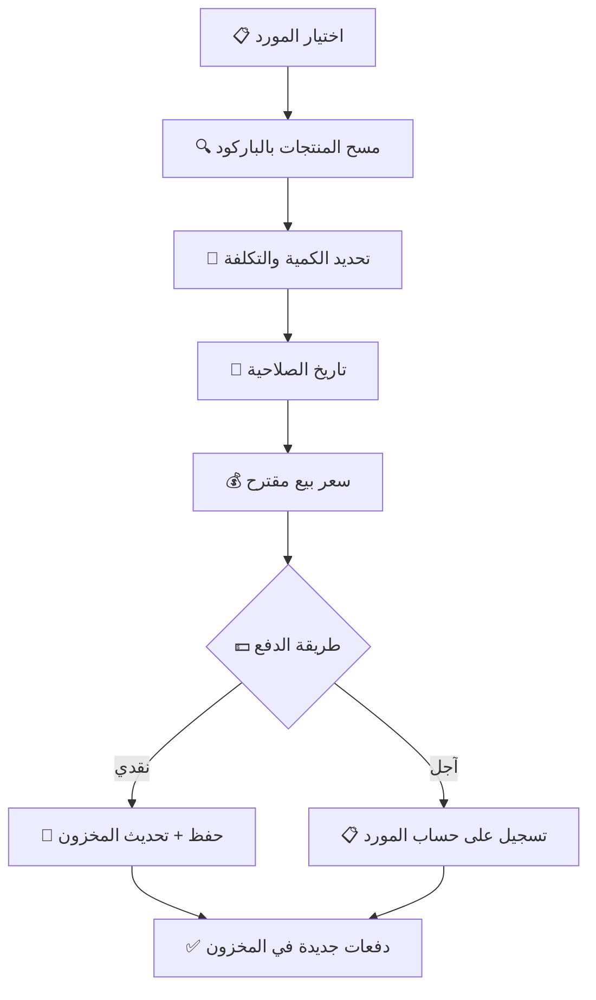
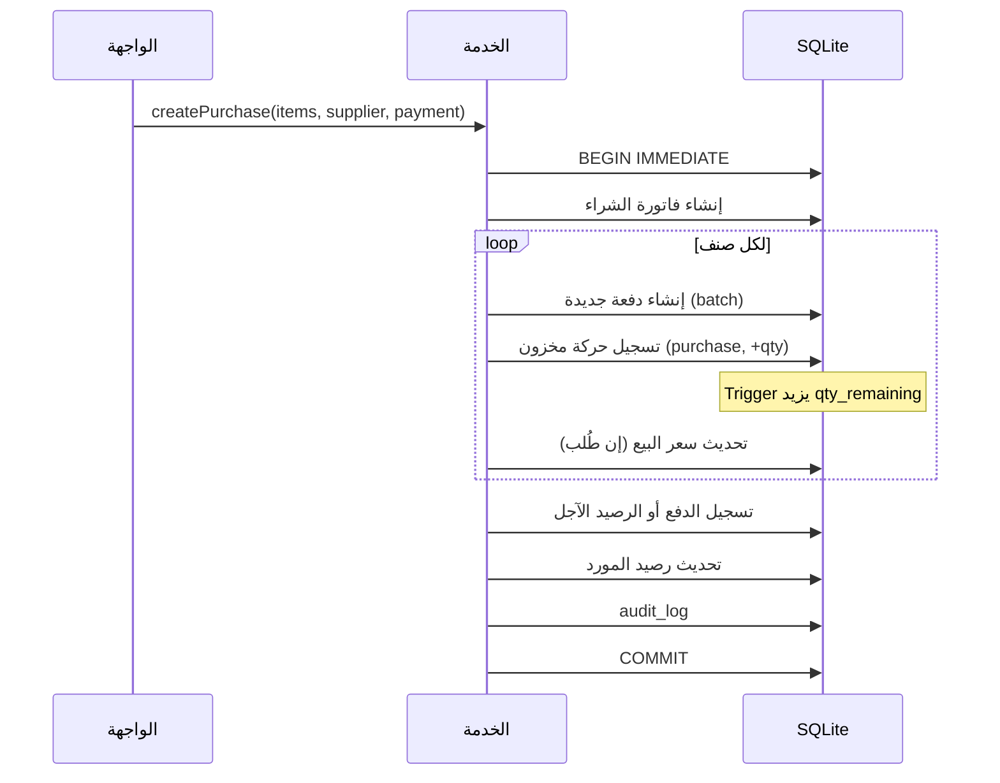

# 🚚 الجزء 05 — المشتريات والموردين

## فواتير الشراء وحسابات الموردين

---

## 1. بيانات المورد

| الحقل | النوع | ملاحظات |
|-------|-------|---------|
| الاسم | نص (مطلوب) | اسم المورد أو الشركة |
| التليفون | نص | رقم التواصل |
| العنوان | نص | |
| الرصيد | رقم (قروش) | المبلغ المستحق للمورد |
| الحالة | نشط/مؤرشف | لا يُحذف مورد له فواتير |

---

## 2. فاتورة الشراء

### 2.1 مسار إنشاء فاتورة شراء:



### 2.2 بيانات سطر الشراء:

| الحقل | الوصف |
|-------|-------|
| المنتج / Variant | المنتج المُشترى |
| الكمية | عدد القطع |
| تكلفة الوحدة | سعر الشراء بالقروش |
| رقم الدفعة | من المورد (أو يُولّد تلقائيًا) |
| تاريخ الصلاحية | تاريخ الانتهاء |
| سعر بيع مقترح | خيار تحديث سعر البيع تلقائيًا |

### 2.3 ماذا يحدث عند حفظ فاتورة الشراء:



---

## 3. الدفع للمورد

### 3.1 أنواع الدفع:

| النوع | الوصف |
|-------|-------|
| **نقدي كامل** | دفع كل المبلغ فوري |
| **آجل كامل** | تسجيل على حساب المورد |
| **جزئي** | دفع جزء نقدي والباقي آجل |

### 3.2 تسجيل دفعات سداد:

```sql
CREATE TABLE supplier_payments (
    id INTEGER PRIMARY KEY,
    uuid TEXT NOT NULL UNIQUE,
    supplier_id INTEGER NOT NULL REFERENCES suppliers(id),
    amount INTEGER NOT NULL CHECK (amount > 0),
    payment_method TEXT NOT NULL,
    note TEXT,
    user_id INTEGER NOT NULL REFERENCES users(id),
    created_at TEXT NOT NULL
);
```

---

## 4. مرتجع الشراء

### المسار:


### القواعد:
- المرتجع مرتبط بفاتورة الشراء الأصلية
- الكمية المرتجعة لا تتجاوز الكمية المشتراة
- يُنشأ حركة مخزون `purchase_return` (سالبة)
- يُعدّل رصيد المورد (ينقص)

---

## 5. تاريخ التكلفة

### الغرض:
تتبع تطور تكلفة كل صنف عبر الزمن ومقارنة الأسعار بين الموردين.

### الاستعلام:

```sql
-- تاريخ تكلفة صنف معين
SELECT 
    p.created_at AS purchase_date,
    s.name AS supplier_name,
    pi.unit_cost,
    pi.qty
FROM purchase_items pi
JOIN purchases p ON pi.purchase_id = p.id
JOIN suppliers s ON p.supplier_id = s.id
WHERE pi.variant_id = ?
ORDER BY p.created_at DESC;

-- مقارنة بين الموردين لنفس الصنف
SELECT 
    s.name AS supplier_name,
    AVG(pi.unit_cost) AS avg_cost,
    MIN(pi.unit_cost) AS min_cost,
    MAX(pi.unit_cost) AS max_cost,
    COUNT(*) AS purchase_count
FROM purchase_items pi
JOIN purchases p ON pi.purchase_id = p.id
JOIN suppliers s ON p.supplier_id = s.id
WHERE pi.variant_id = ?
GROUP BY s.id
ORDER BY avg_cost ASC;
```

---

## 6. كشف حساب المورد

### المعلومات:

| البيان | الوصف |
|--------|-------|
| اسم المورد | |
| الرصيد الحالي | المبلغ المستحق |
| إجمالي المشتريات | |
| إجمالي المسدد | |
| تفاصيل الحركات | فواتير + دفعات سداد + مرتجعات |

### الاستعلام:

```sql
-- كشف حساب المورد
SELECT 
    'purchase' AS type,
    p.created_at AS date,
    p.total AS debit,
    0 AS credit,
    'فاتورة شراء رقم ' || p.id AS description
FROM purchases p
WHERE p.supplier_id = ?

UNION ALL

SELECT 
    'payment' AS type,
    sp.created_at AS date,
    0 AS debit,
    sp.amount AS credit,
    'دفعة سداد' AS description
FROM supplier_payments sp
WHERE sp.supplier_id = ?

UNION ALL

SELECT 
    'return' AS type,
    pr.created_at AS date,
    0 AS debit,
    pr.total_refund AS credit,
    'مرتجع شراء' AS description
FROM purchase_returns pr
WHERE pr.supplier_id = ?

ORDER BY date ASC;
```

---

## 7. ملخص API الـ IPC

| القناة | الوظيفة |
|--------|---------|
| `suppliers:list` | قائمة الموردين |
| `suppliers:get` | تفاصيل مورد |
| `suppliers:create` | إنشاء مورد |
| `suppliers:update` | تحديث بيانات المورد |
| `suppliers:statement` | كشف حساب المورد |
| `purchases:create` | إنشاء فاتورة شراء |
| `purchases:list` | قائمة فواتير الشراء |
| `purchases:return` | مرتجع شراء |
| `purchases:pay` | تسجيل دفعة سداد |
| `purchases:cost-history` | تاريخ تكلفة صنف |
