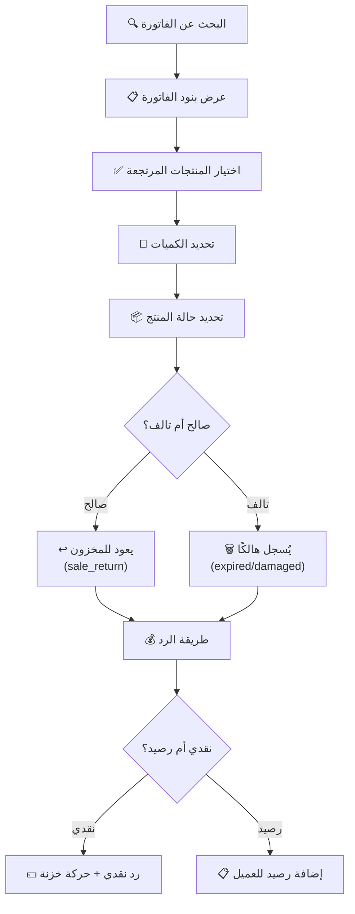
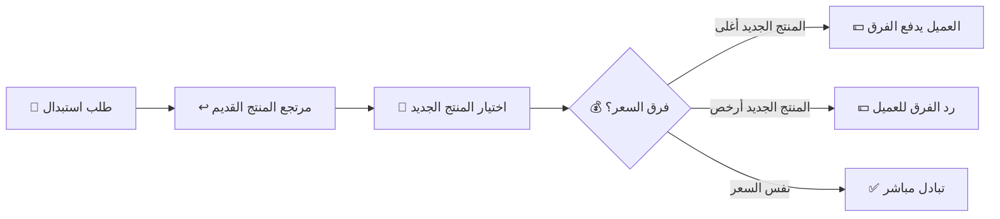
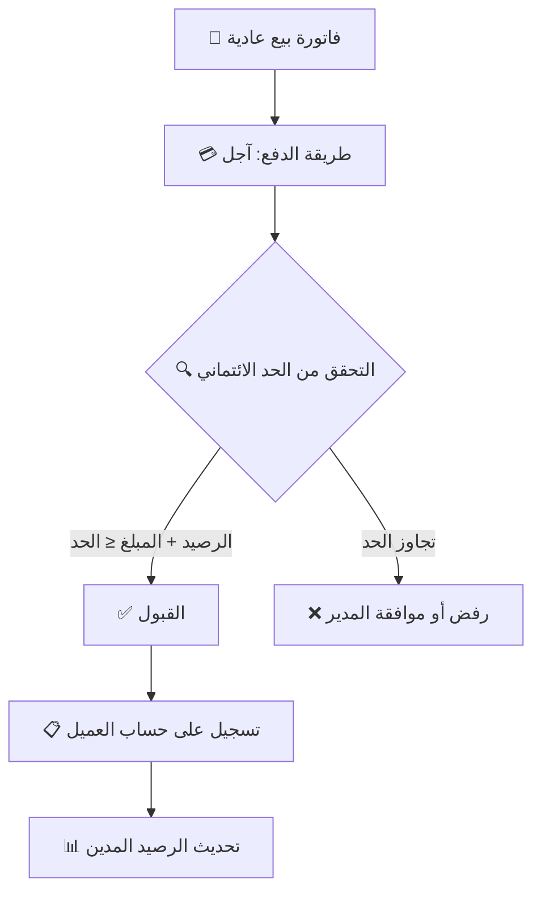

# 🔄 الجزء 06 — المرتجعات والعملاء

## المرتجعات والاستبدال والعملاء والبيع بالآجل

---

## 1. المرتجعات

### 1.1 القواعد الأساسية:

| القاعدة | التفصيل |
|---------|---------|
| المرتجع مرتبط بالفاتورة الأصلية | لا مرتجع بدون فاتورة |
| الكمية المرتجعة ≤ الكمية المباعة | لا يمكن إرجاع أكثر مما بيع |
| حالة المنتج المرتجع | صالح (يعود للمخزون) أو تالف (هالك) |
| سياسة قابلة للضبط | مدة الإرجاع + شروط المنتجات المفتوحة |
| تسجيل المستخدم والسبب | كل مرتجع بسبب ومستخدم مسؤول |

### 1.2 مسار المرتجع:



### 1.3 سياسة المنتجات المفتوحة (مستحضرات التجميل):

```
⚠️ مستحضرات التجميل المفتوحة قد لا تُرجع لأسباب صحية.
هذه السياسة تُحدد من الإعدادات:
  - مدة الإرجاع المسموحة (أيام)
  - هل يُقبل إرجاع المنتج المفتوح؟
  - هل يحتاج موافقة المدير؟
```

### 1.4 ماذا يحدث عند حفظ المرتجع:

```
1. إنشاء سجل returns مع ربطه بالفاتورة الأصلية
2. لكل منتج صالح:
   → حركة مخزون sale_return (+qty) على نفس الدفعة
3. لكل منتج تالف:
   → حركة مخزون (لا يعود للمخزون)
4. طريقة الرد:
   → نقدي: حركة refund في cash_movements
   → رصيد: إضافة لرصيد العميل
5. تسجيل في audit_log
```

---

## 2. الاستبدال

### المفهوم:
**الاستبدال = مرتجع + بيع جديد في عملية واحدة**

### المسار:



### القيد التقني:
- يُنشأ كـ transaction واحد يشمل المرتجع والبيع الجديد
- إذا فشل أي جزء: ROLLBACK كامل

---

## 3. العملاء

### 3.1 بيانات العميل:

| الحقل | النوع | ملاحظات |
|-------|-------|---------|
| الاسم | نص (مطلوب) | |
| التليفون | نص | |
| الحد الائتماني | رقم (قروش) | أقصى مبلغ آجل |
| الرصيد المدين | رقم (قروش) | المبلغ المستحق على العميل |
| الحالة | نشط/مؤرشف | لا يُحذف عميل له فواتير |

### 3.2 سجل مشتريات العميل:

```sql
-- كل فواتير عميل معين
SELECT s.seq_no, s.created_at, s.total, s.status
FROM sales s
WHERE s.customer_id = ?
ORDER BY s.created_at DESC;
```

---

## 4. البيع بالآجل (Credit Sales)

### 4.1 المسار:



### 4.2 تسجيل دفعات العميل:

```sql
CREATE TABLE customer_payments (
    id INTEGER PRIMARY KEY,
    uuid TEXT NOT NULL UNIQUE,
    customer_id INTEGER NOT NULL REFERENCES customers(id),
    amount INTEGER NOT NULL CHECK (amount > 0),
    payment_method TEXT NOT NULL,
    note TEXT,
    user_id INTEGER NOT NULL REFERENCES users(id),
    created_at TEXT NOT NULL
);
```

### 4.3 عند تسجيل دفعة:
1. إنشاء سجل `customer_payments`
2. تقليل `customers.balance` بمبلغ الدفعة
3. تسجيل حركة نقدية في `cash_movements` (إن كانت نقدية)
4. `audit_log`

---

## 5. كشف حساب العميل

### المعلومات:

```sql
-- كشف حساب العميل
SELECT 
    'sale' AS type,
    s.created_at AS date,
    s.total AS debit,
    0 AS credit,
    'فاتورة رقم ' || s.seq_no AS description
FROM sales s
JOIN sale_payments sp ON sp.sale_id = s.id
WHERE s.customer_id = ? AND sp.method = 'credit'

UNION ALL

SELECT 
    'payment' AS type,
    cp.created_at AS date,
    0 AS debit,
    cp.amount AS credit,
    'دفعة سداد' AS description
FROM customer_payments cp
WHERE cp.customer_id = ?

UNION ALL

SELECT 
    'return' AS type,
    r.created_at AS date,
    0 AS debit,
    r.total_refund AS credit,
    'مرتجع' AS description
FROM returns r
JOIN sales s ON r.sale_id = s.id
WHERE s.customer_id = ? AND r.refund_method = 'credit'

ORDER BY date ASC;
```

---

## 6. ملخص API الـ IPC

| القناة | الوظيفة |
|--------|---------|
| `returns:create` | إنشاء مرتجع |
| `returns:exchange` | استبدال (مرتجع + بيع) |
| `returns:list` | قائمة المرتجعات |
| `customers:list` | قائمة العملاء |
| `customers:get` | تفاصيل عميل |
| `customers:create` | إنشاء عميل |
| `customers:update` | تحديث بيانات العميل |
| `customers:pay` | تسجيل دفعة سداد |
| `customers:statement` | كشف حساب العميل |
| `customers:history` | سجل مشتريات العميل |
