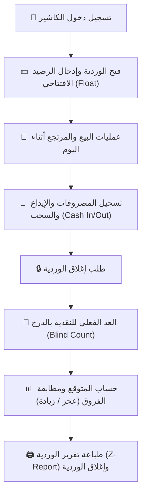

# 💰 الجزء 07 — الخزنة والورديات والمصروفات

## إدارة النقدية وحركات الدرج والمصروفات وإغلاق الورديات (Z-Report)

---

## 1. فلسفة إدارة النقدية

| المبدأ | التفصيل |
|--------|---------|
| **دفتر نقدية موحد (Append-Only)** | كل قرش يدخل أو يخرج من درج الكاشير يسجل كحركة نقدية (`cash_movements`) لا تُعدل ولا تُحذف. |
| **ربط كل حركة بوردية** | لا يمكن البيع أو الصرف دون وردية مفتوحة (`shift_id` إلزامي). |
| **العد الأعمى عند الإغلاق (Blind Count)** | الكاشير يُدخل المبلغ الفعلي الموجود في الدرج أولاً، ثم يُظهر النظام المتوقع والفرق (عجز/زيادة). |
| **سحب الفائض (Cash Drop)** | تفريغ النقدية الزائدة إلى الخزنة الرئيسية لتأمين الدرج أثناء العمل. |
| **تتبع المسؤوليات** | تسجيل اسم المستخدم ورقم العملية ووقت التنفيذ لكل حركة نقدية. |

---

## 2. دورة حياة الوردية (Shift Lifecycle)



---

## 3. تفاصيل مراحل الوردية

### 3.1 فتح الوردية (Open Shift)
- يُطلب من الكاشير إدخال **الرصيد الافتتاحي (الفكة بالدرج)**.
- يسجل النظام:
  - `user_id` (الكاشير المسؤول)
  - `opening_balance` (بالقروش)
  - `opened_at` (تاريخ ووقت الفتح UTC)
  - `status = 'open'`
- **قاعدة أمان:** لا يمكن للمستخدم فتح ورديتين في نفس الوقت على نفس الجهاز.

### 3.2 العمليات النقدية أثناء الوردية

كل عملية مالية تنشئ فوراً سجلاً في `cash_movements`:

| نوع الحركة (`type`) | التأثير على الدرج | المصدر / المرجع |
|--------------------|-------------------|-----------------|
| `sale` | ➕ زيادة | فاتورة بيع نقدية (`sales`) |
| `refund` | ➖ نقص | فاتورة مرتجع نقدي (`returns`) |
| `expense` | ➖ نقص | مصروف نثري (`expenses`) |
| `deposit` (Cash In) | ➕ زيادة | تزويد فكة إضافية أو إيداع طارئ |
| `withdrawal` (Cash Drop) | ➖ نقص | تحويل نقدية لخزنة المحل أو للمالك |

### 3.3 معادلة الرصيد المتوقع بالدرج:

$$\text{الرصيد المتوقع} = \text{الافتتاحي} + \text{مبيعات الكاش} - \text{مرتجعات الكاش} - \text{المصروفات} + \text{الإيداعات} - \text{المسحوبات}$$

> **⚠️ تنبيه:** مبيعات البطاقة (Visa/Mastercard) والمحافظ الإلكترونية (فودافون كاش/إنستاباي) والبيع الآجل **لا تُحسب ضمن رصيد الدرج النقدي**، ولكنها تظهر في ملخص التقرير بشكل منفصل.

---

## 4. إغلاق الوردية وتقرير Z-Report

### 4.1 العد الأعمى (Blind Reconciliation)
1. الكاشير يضغط على "إغلاق الوردية".
2. تظهر شاشة تطلب تفقيط وعد الفئات النقدية (200، 100، 50، 20، 10، 5، فكة) أو إجمالي النقدية.
3. لا يرى الكاشير المبلغ المحسوب بالنظام قبل إدخال عده الفعلي (لمنع التلاعب أو التوفيق الصوري).
4. بعد الإدخال، يحسب النظام:
   - **الرصيد المتوقع** (`expected_balance`)
   - **الرصيد الفعلي** (`closing_balance`)
   - **الفارق** (`difference`):
     - `difference = 0` ⬅️ متطابق تماماً
     - `difference < 0` ⬅️ **عجز نقدي (Shortage)**
     - `difference > 0` ⬅️ **زيادة نقدية (Overage)**
5. يُطلب سبب وتبرير مسجل في حال وجود فارق يتجاوز الحد المسموح (مثلاً 5 جنيهات).

### 4.2 محتويات إيصال إغلاق الوردية (Z-Report):

```text
==================================================
           تقرير إغلاق الوردية (Z-Report)
                  محل بلوم للجمال
==================================================
رقم الوردية: #00128
الكاشير: فاطمة علي
تاريخ الفتح:  2026-10-11 09:00 ص
تاريخ الإغلاق: 2026-10-11 05:30 م
--------------------------------------------------
1. ملخص المبيعات:
   - إجمالي المبيعات (Gross):       12,450.00 ج.م
   - الخصومات الممنوحة:             (350.00) ج.م
   - صافي المبيعات (Net):           12,100.00 ج.م
   - المرتجعات:                     (450.00) ج.م
   - عدد الفواتير:                  48 فاتورة
   - متوسط الفاتورة:                252.00 ج.م

2. تحليل طرق الدفع:
   - نقدي (Cash):                   7,200.00 ج.م
   - بطاقات ائتمان (Card):          3,100.00 ج.م
   - محافظ إلكترونية (Wallet):     1,350.00 ج.م
   - بيع بالآجل (Credit):            450.00 ج.م

3. حركة درج النقدية:
   - الرصيد الافتتاحي:              500.00 ج.م
   - (+) المبيعات النقدية:          7,200.00 ج.م
   - (-) المرتجعات النقدية:         (200.00) ج.م
   - (-) المصروفات النثرية:         (150.00) ج.م
   - (-) توريد للمالك (Cash Drop):  (5,000.00) ج.م
   -----------------------------------------------
   = الرصيد المتوقع بالدرج:         2,350.00 ج.م
   = النقدية الفعلية بعد العد:      2,350.00 ج.م
   = الفارق (عجز / زيادة):          0.00 ج.م
--------------------------------------------------
توقيع الكاشير: ...............   توقيع المدير: ...............
==================================================
```

---

## 5. المصروفات النثرية (Expenses)

### 5.1 تصنيفات المصروفات المسبقة:
- إيجار ومرافق (كهرباء، مياه، إنترنت).
- أدوات نظافة ومستلزمات تعبئة وأكياس.
- شحن ونقل ومواصلات بضاعة.
- وجبات وضيافة المحل.
- صيانة دورية وإصلاحات.
- مسحوبات شخصية للمالك (تُعامل كبند منفصل عن المصروفات التشغيلية لحساب الربح الصافي بدقة).

### 5.2 قواعد الصرف:
1. المصروف من الدرج ينشئ سجلاً في `expenses` وحركة سالبة في `cash_movements`.
2. ربط المصروف برقم الفاتورة الورقية أو صورة الإيصال (إن وجدت).
3. إمكانية وضع سقف للمصروفات التي يملك الكاشير صلاحية صرفها (مثلاً حتى 100 ج.م)، وما زاد يتطلب موافقة المدير بالـ PIN.

---

## 6. الخزنة الرئيسية وسندات الإيداع والسحب

### 6.1 الخزنة الرئيسية (Main Safe):
- مستودع النقدية الرئيسي للمحل، المنفصل عن أدراج الكاشير.
- عند إغلاق كل وردية أو عند عمل Cash Drop، تُرحل النقدية إلى الخزنة الرئيسية.
- سداد دفعات الموردين الكبيرة أو سداد الإيجار يتم غالباً من الخزنة الرئيسية وليس من درج الكاشير.

### 6.2 سندات القبض والصرف:
- **سند صرف (Cash Out / Expense):** يطبع إيصالاً صغيراً لتوقيع المستلم.
- **سند قبض (Cash In):** استلام دفعة من عميل آجل أو توريد نقدية من المالك.

---

## 7. الربط مع قاعدة البيانات والخدمات

```typescript
// services/cashService.ts

interface OpenShiftParams {
  userId: number;
  openingBalancePiaster: number;
}

interface CloseShiftParams {
  shiftId: number;
  closingBalancePiaster: number;
  notes?: string;
}

interface CashMovementParams {
  shiftId: number;
  type: 'sale' | 'refund' | 'expense' | 'deposit' | 'withdrawal';
  amountPiaster: number; // موجب دائماً، والنوع يحدد الإشارة بالتقرير
  refType?: 'sale' | 'return' | 'expense' | 'supplier_payment' | 'customer_payment';
  refId?: number;
  note?: string;
}
```

### استعلام تجميع رصيد الوردية:
```sql
SELECT 
    s.id,
    s.opening_balance,
    COALESCE(SUM(CASE WHEN cm.type IN ('sale', 'deposit') THEN cm.amount ELSE 0 END), 0) AS total_in,
    COALESCE(SUM(CASE WHEN cm.type IN ('refund', 'expense', 'withdrawal') THEN cm.amount ELSE 0 END), 0) AS total_out,
    (s.opening_balance 
     + COALESCE(SUM(CASE WHEN cm.type IN ('sale', 'deposit') THEN cm.amount ELSE 0 END), 0)
     - COALESCE(SUM(CASE WHEN cm.type IN ('refund', 'expense', 'withdrawal') THEN cm.amount ELSE 0 END), 0)
    ) AS calculated_expected
FROM shifts s
LEFT JOIN cash_movements cm ON cm.shift_id = s.id
WHERE s.id = :shiftId
GROUP BY s.id;
```
