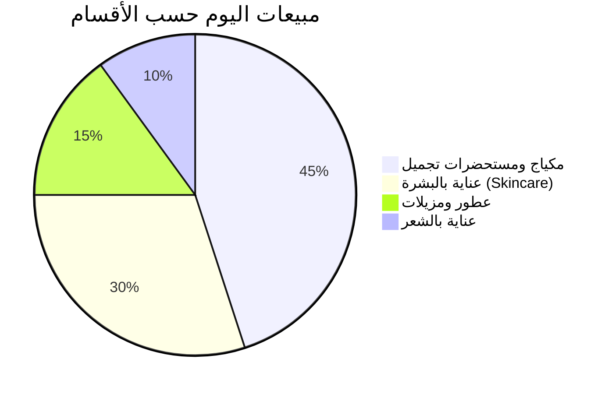

# 📈 الجزء 08 — التقارير ولوحة التحكم والإعدادات

## لوحة المؤشرات والتقارير المالية والتشغيلية وتهيئة النظام الشاملة

---

## 1. لوحة التحكم اللحظية (Executive Dashboard)

شاشة البداية للإدارة والمالك لتقديم نبض فوري عن نشاط المحل اليومي دون الحاجة لفتح تقارير معقدة.

### 1.1 بطاقات المؤشرات اللحظية (KPI Cards):
- 💵 **إجمالي مبيعات اليوم:** مقارنة بنفس اليوم من الأسبوع الماضي (+/- %).
- 💎 **صافي الأرباح المقدرة اليوم:** محسوبة على التكلفة الدقيقة للدفعات المباعة.
- 🧾 **عدد الفواتير المنفذة:** ومتوسط قيمة الفاتورة (Basket Size).
- 🚨 **تنبيهات فورية:**
  - عدد المنتجات تحت حد الطلب (نواقص).
  - عدد المنتجات القريبة من انتهاء الصلاحية (< 30 يوماً).
  - حالة الوردية الحالية ورصيد الدرج اللحظي.

### 1.2 الرسوم البيانية التفاعلية:


- **منحنى الذروة الساعي (Hourly Sales):** يوضح حركة المبيعات ساعة بساعة لمعرفة أوقات الذروة وتوزيع نوبات العمل.
- **أفضل 5 منتجات مبيعاً اليوم:** الصنف، الكمية المباعة، والإيراد.

---

## 2. منظومة التقارير الشاملة

> **📌 مبدأ أساسي:** جميع التقارير تدعم التصفية حسب: الفترة الزمنية (اليوم، أمس، آخر 7 أيام، هذا الشهر، مخصص)، الكاشير، القسم، الماركة، طريقة الدفع.

### 2.1 تقارير المبيعات (Sales Reports)

| التقرير | المحتوى والأعمدة | الفائدة للمحل |
|---------|------------------|---------------|
| **ملخص المبيعات اليومي/الدوري** | التاريخ، إجمالي المبيعات، الخصومات، الصافي، الضريبة، تكلفة البضاعة المباعة (COGS)، مجمل الربح، نسبة هامش الربح %. | معرفة الدخل وحجم النشاط اليومي ومقارنة الفترات. |
| **المبيعات حسب طرق الدفع** | نقدي، بطاقات بنكية، محافظ إلكترونية، بيع آجل، دفعات مجمعة. | مطابقة الحسابات البنكية ومحافظ الكاش مع فواتير المحل. |
| **المبيعات حسب الأقسام والماركات** | القسم/الماركة، الكميات المباعة، إجمالي الإيراد، المساهمة النسبية %. | معرفة العلامات التجارية الأكثر رواجاً للتفاوض مع مورديها. |
| **المبيعات حسب الكاشير** | اسم المستخدم، عدد الفواتير، قيمة المبيعات، الخصومات الممنوحة، المرتجعات. | تقييم كفاءة الكاشير ومتابعة نسب الخصم الممنوحة من كل بائع. |
| **تقرير الفواتير التفصيلي** | رقم الفاتورة، الوقت، الكاشير، العميل، الأصناف، الإجمالي، الحالة (مكتملة/ملغاة/مرتجع). | المراجعة والتدقيق والبحث عن فاتورة معينة. |

### 2.2 تقارير الأرباح الدقيقة (Profitability & Margins)

بفضل نظام **الدفعات (Batches)**، يُحسب الربح الحقيقي لكل فاتورة وسطر بيع:

$$\text{مجمل الربح للصنف} = (\text{سعر البيع} - \text{تكلفة الدفعة الفعلية}) \times \text{الكمية المباعة} - \text{الخصم المطبق}$$

- **تقرير الأصناف الأعلى ربحاً:** يرتب المنتجات حسب صافي الجنيهات المحققة وليس مجرد الكمية.
- **تقرير هامش الربح:** يرصد المنتجات ذات الهامش المنخفض جداً لمراجعة تسعيرها.

### 2.3 تقارير المخزون والصلاحية (Inventory & Expiry)

| التقرير | التفاصيل | إجراء المعالجة المقترح |
|---------|----------|------------------------|
| **تقييم المخزون الحالي** | كميات جميع الأصناف × تكلفة الشراء، وقيمتها بسعر البيع، والأرباح المتوقعة عند البيع. | معرفة رأس المال العامل في البضاعة والموجودات. |
| **تقرير تواريخ الصلاحية** | المنتجات المصنفة حسب: منتهية، أقل من 30 يوم، أقل من 60 يوم، أقل من 90 يوم مع أرقام الدفعات ومواقعها. | عمل عروض تخفيض أو استبدال مع المورد قبل الفوات. |
| **النواقص وحد الطلب** | المنتجات التي رصيدها الحالي ≤ `min_stock` مع الكمية المقترحة للشراء. | إنشاء مسودة أمر شراء فورية للموردين. |
| **المنتجات الراكدة (Dead Stock)** | أصناف لم تسجل أي حركة بيع خلال (30 / 60 / 90 يوماً). | تسييل البضاعة الراكدة بعروض ترويجية لتوفير سيولة. |
| **كرت حركة الصنف (Item Ledger)** | تاريخ ووقت كل حركة (شراء، بيع، مرتجع، هالك، عينة، تسوية) والرصيد بعدها والمستخدم المسؤول. | التحقيق في أي عجز أو تلاعب بالمخزون. |
| **فروقات الجرد والتسويات** | الرصيد الدفتري vs الفعلي، قيمة العجز وقيمة الزيادة وأسباب التسوية. | محاسبة المسؤولين وضبط الهدر. |

### 2.4 تقارير الحسابات المالية والخزنة

- **تقرير الورديات وZ-Reports:** سجل كامل لجميع الورديات المغلقة، النقدية المتوقعة والفعلية، وفروق العجز والزيادة.
- **تقرير المصروفات النثرية:** إجمالي المصروفات موزعة حسب بنودها (إيجار، كهرباء، صيانة، بوفيه، نقل).
- **كشف حساب العملاء الآجلين:** أرصدة العملاء، سجل الفواتير والدفعات، وتنبيه الديون المتأخرة.
- **كشف حساب الموردين:** المبالغ المستحقة لكل مورد، وتواريخ استحقاق الفواتير، وسجل المدفوعات السابقة.

---

## 3. تصدير التقارير والطباعة (Export & Reporting)

```
        ┌────────────────────────────────┐
        │        شاشة عرض التقرير        │
        └───────┬────────────────┬───────┘
                │                │
       [تصدير Excel / CSV]   [طباعة PDF / ورق A4]
                │                │
        - ملف .xlsx منظم     - ترويسة وشعار المحل
        - معادلات وأعمدة     - تنسيق RTL عربي أنيق
        - جاهز للمحاسب       - أرقام الصفحات والتاريخ
```

- **تصدير Excel/CSV:** بضغطة زر واحدة باستخدام مكتبة محلية أوفلاين (مثل `exceljs`).
- **تصدير وطباعة PDF:** معاينة سريعة قبل الطباعة وتنسيق يلائم التقارير الرسمية وحسابات الضرائب.

---

## 4. شاشة الإعدادات العامة (Settings — Zero Hardcoding)

> **قاعدة التطوير الذهبية:** لا يوجد أي متغير تجاري مكتوب بصورة ثابتة (Hardcoded) في الكود، كل شيء يدار من جدول `settings` في قاعدة البيانات.

### 4.1 تبويبات شاشة الإعدادات:

#### أ. بيانات المحل والهوية (Store Profile):
- اسم المحل باللغتين (العربية والإنجليزية).
- شعار المحل (Upload Logo بصيغة PNG/JPG مع ضغط وتخزين محلي).
- عنوان المحل ورقم الهاتف المحمول ورقم الواتساب.
- الرقم الضريبي والسجل التجاري (اختياري للإيصال).
- نص الترويسة ورسالة تذييل الإيصال (مثال: *"شكراً لزيارتكم — البضاعة المباعة ترد وتستبدل خلال 14 يوماً وفق الشروط"*).

#### ب. إعدادات نقطة البيع والطباعة (POS & Hardware):
- اختيار طابعة الإيصالات الحرارية الافتراضية من طابعات ويندوز المثبتة.
- حجم ورق الإيصالات: `80mm` (الافتراضي) أو `58mm` أو `A4`.
- خيار فتح درج النقدية التلقائي عند طباعة الفاتورة النقدية (Drawer Kick Pulse).
- عدد نسخ طباعة الفاتورة الافتراضي (نسخة واحدة / نسختان).
- سلوك مسح الباركود عند تكرار نفس الصنف (زيادة الكمية تلقائياً ➕1).

#### ج. سياسات البيع والمخزون (Business Rules):
- **البيع عند رصيد صفر:**
  - ⭕ منع البيع نهائياً (Strict).
  - ⚠️ السماح مع إظهار تحذير للكاشير (Warning).
- **حدود الخصم:**
  - أقصى نسبة خصم يسمح بها للكاشير دون الرجوع للمدير (مثلاً 5%).
  - أي خصم أعلى يتطلب إدخال PIN المدير/المالك.
- **سياسة تواريخ الصلاحية:**
  - فترات التنبيه المبكر (افتراضياً: 30، 60، 90 يوماً).
  - منع بيع أي منتج انتهت صلاحيته قطعياً ومنع تجاوزه حتى بـ PIN.
- **سياسة المرتجعات:**
  - المهلة الزمنية المسموحة للإرجاع بالفاتورة (مثلاً 14 يوماً).
  - اشتراط موافقة المدير على المرتجع (نعم/لا).
  - قبول إرجاع مستحضرات التجميل المفتوحة (ممنوع/مشروط بموافقة المدير).

#### د. المظهر واللغة (Appearance & Regional):
- النمط اللوني: الوضع الفاتح (Light) / الوضع الداكن (Dark) / ثيم مستحضرات التجميل الزهري الهادئ (Rose Gold Theme).
- تنسيق الأرقام والعملة: رمز العملة (`ج.م` أو `EGP`)، عدد الخانات العشرية (2 خانات).
- مسار مجلد النسخ الاحتياطي التلقائي (Local Backup Path).

---

## 5. هيكل جدول الإعدادات البرمجي

```sql
CREATE TABLE settings (
    key TEXT PRIMARY KEY,
    value TEXT NOT NULL,
    category TEXT NOT NULL,         -- 'store', 'pos', 'inventory', 'printing', 'system'
    data_type TEXT NOT NULL DEFAULT 'string', -- 'string', 'number', 'boolean', 'json'
    updated_at TEXT NOT NULL
);
```

### أمثلة على الإعدادات المخزنة:
```json
{
  "store_name": "محل بلوم لمستحضرات التجميل",
  "store_phone": "01001234567",
  "receipt_footer": "شكراً لزيارتكم! تابعينا على إنستجرام @bloom_beauty",
  "printer_name": "POS-80C",
  "receipt_width": "80mm",
  "allow_zero_stock_sale": "false",
  "max_cashier_discount_percent": "5",
  "expiry_alert_days": "[30, 60, 90]",
  "return_window_days": "14",
  "require_manager_return": "true",
  "auto_backup_enabled": "true",
  "auto_backup_path": "D:\\BeautyStore_Backups"
}
```
