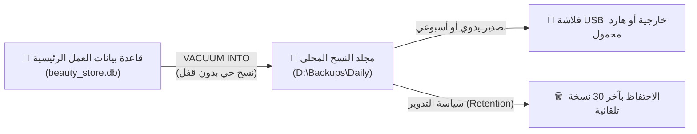

# 🛡️ الجزء 09 — الأمان والصلاحيات والنسخ الاحتياطي

## إدارة المستخدمين، مصفوفة الصلاحيات، سجل الرقابة، واستراتيجية منع فقدان البيانات

---

## 1. فلسفة الأمان في بيئة المحل الأوفلاين

يعمل التطبيق داخل بيئة محل تجاري (Offline Desktop)، حيث التهديدات الحقيقية ليست اختراقات الإنترنت، بل:
1. التلاعب بالأرقام وسرقة النقدية أو المنتجات.
2. أخطاء الكاشير غير المقصودة وتعديل الفواتير القديمة.
3. انقطاع التيار الكهربائي المفاجئ أثناء تسجيل عملية بيع.
4. تعطل القرص الصلب أو إصابة الجهاز بفيروس وضياع البيانات بالكامل.

---

## 2. منظومة المستخدمين والمصادقة (Authentication)

### 2.1 أدوار النظام الثلاثة (User Roles):
- 👑 **المالك (Owner):** الصلاحيات الكاملة، إدارة الحسابات، الاطلاع على هوامش الربح وصافي الأرباح، تعديل الإعدادات العامة، إدارة النسخ الاحتياطي والاسترجاع.
- 👔 **المدير (Manager):** إشراف تشغيلي، اعتماد الخصومات فوق الحد، اعتماد المرتجعات والتسويات الجردية، إدارة فواتير الشراء، دون رؤية أرباح المالك الصافية.
- 🧑‍💼 **الكاشير (Cashier):** واجهة البيع السريع (POS)، استعراض أسعار الأصناف ومخزونها، فتح وإغلاق ورديته الخاصة، إدخال المرتجعات البسيطة، دون رؤية تكلفة الشراء أو تقارير الأرباح.

### 2.2 طرق تسجيل الدخول:
- **دخول سريع برمز PIN (4 إلى 6 أرقام):** مخصص لشاشة البيع، لتمكين الكاشير من الدخول بسرعة دون كتابة كلمة مرور معقدة على لوحة المفاتيح.
- **دخول المالك/المدير:** اسم مستخدم وكلمة مرور مشفرة، مع إمكانية استخدام PIN للموافقات السريعة أثناء الوردية (Manager Override).
- **القفل التلقائي للشاشة (Auto Lock):** بعد 5 دقائق من الخمول، تقفل الشاشة تلقائياً لحماية النظام في حال ترك الكاشير للكاونتر.
- **تشفير كلمات المرور:** باستخدام خوارزمية `bcrypt` أو `argon2id` محلياً داخل التطبيق، ويُمنع منعاً باتاً تخزين أي رمز كـ Plain Text.

---

## 3. مصفوفة الصلاحيات التفصيلية (RBAC Matrix)

| العملية / الصلاحية | الكاشير (Cashier) | المدير (Manager) | المالك (Owner) | ملاحظات الحماية |
|--------------------|:----------------:|:----------------:|:--------------:|-----------------|
| **مسح الباركود وإتمام البيع** | ✅ متاح | ✅ متاح | ✅ متاح | الوظيفة الأساسية |
| **تطبيق خصم حتى 5%** | ✅ متاح | ✅ متاح | ✅ متاح | سقف محدد من الإعدادات |
| **تطبيق خصم أكبر من 5%** | ❌ يتطلب PIN | ✅ متاح | ✅ متاح | يظهر مربع طلب رمز المدير |
| **تعليق واسترجاع الفواتير** | ✅ متاح | ✅ متاح | ✅ متاح | لخدمة زبونين معاً |
| **إلغاء بند أثناء البيع** | ✅ متاح | ✅ متاح | ✅ متاح | يسجل في Audit Log إذا تم تكراره |
| **إلغاء فاتورة بعد حفظها** | ❌ ممنوع قطعي | ❌ ممنوع قطعي | ❌ ممنوع قطعي | التصحيح عبر مرتجع فقط |
| **إجراء مرتجع بفاتورة** | ✅ مشروط | ✅ متاح | ✅ متاح | حسب سياسة الإعدادات |
| **مرتجع بدون فاتورة** | ❌ ممنوع | ❌ يتطلب PIN مالك | ✅ متاح | استثناء مقيد جداً |
| **فتح درج النقدية يدوياً (No Sale)** | ❌ يتطلب إذن | ✅ متاح | ✅ متاح | تسجل الحركة كحدث رقابي |
| **تسجيل مصروف نثري من الدرج** | ✅ حتى حد معين | ✅ متاح | ✅ متاح | إيصال وبيان بالمصروف |
| **رؤية تكلفة الشراء (Cost)** | ❌ محجوبة تماماً | ⚠️ اختيارية | ✅ متاح | إخفاء التكلفة عن العاملين |
| **رؤية تقارير الأرباح الصافية** | ❌ محجوبة | ❌ محجوبة | ✅ متاح | للمالك فقط |
| **تعديل أسعار المنتجات والبيانات** | ❌ ممنوع | ✅ متاح | ✅ متاح | عبر شاشة إدارة المنتجات |
| **إجراء جرد واعتماد التسويات** | ❌ مسح وعد فقط | ✅ متاح | ✅ متاح | الكاشير يعد والمدير يعتمد |
| **تسجيل فواتير الشراء للموردين** | ❌ ممنوع | ✅ متاح | ✅ متاح | قسم المشتريات |
| **تعديل الإعدادات العامة للنظام** | ❌ ممنوع | ❌ ممنوع | ✅ متاح | ترويسة الفاتورة والسياسات |
| **أخذ نسخة احتياطية وتصديرها** | ❌ ممنوع | ✅ متاح | ✅ متاح | حفظ على فلاشة خارجية |
| **استرجاع نسخة احتياطية (Restore)** | ❌ ممنوع | ❌ ممنوع | ✅ متاح | كلمة مرور المالك مطلوبة |

---

## 4. سجل التدقيق والرقابة (Audit Log)

جدول غير قابل للتعديل أو الحذف (`append-only`) يرصد الحركات الحساسة داخل المحل:

```sql
CREATE TABLE audit_log (
    id INTEGER PRIMARY KEY,
    user_id INTEGER NOT NULL REFERENCES users(id),
    action TEXT NOT NULL,           -- 'login', 'override_discount', 'refund', 'open_drawer', 'stock_adjust', 'price_change'
    entity_type TEXT,               -- 'sale', 'product', 'batch', 'shift'
    entity_id INTEGER,
    details TEXT,                   -- JSON يحوي القيم السابقة والجديدة
    ip_or_host TEXT,
    created_at TEXT NOT NULL
);
```

### أحداث رقابية يتم رصدها فورياً:
1. منح خصم استثنائي (تسجيل اسم الكاشير واسم المدير الذي منح الموافقة ومقدار الخصم).
2. فتح درج النقدية اليدوي بزر F12 دون وجود فاتورة بيع نقدية.
3. تعديل سعر بيع منتج من شاشة إدارة المنتجات (السعر القديم والجديد).
4. تسوية جردية بالزيادة أو النقص (الكمية الدفترية والكمية الفعلية المعتمدة).
5. محاولات تسجيل الدخول الخاطئة المتكررة (تجميد الحساب مؤقتاً بعد 5 محاولات فاشلة).

---

## 5. استراتيجية "صفر أخطاء" وحماية البيانات

### 5.1 معاملات ذرية حاسمة (Atomic ACID Transactions)
- كل عملية بيع تدار عبر `BEGIN IMMEDIATE TRANSACTION`:
  1. خصم كميات الدفعات بأسلوب FEFO.
  2. إنشاء سطر الفاتورة واللقطة السعرية (Snapshot).
  3. إنشاء سجل الدفع المالي.
  4. تسجيل حركة المخزون في `stock_movements`.
  5. تسجيل حركة النقدية في `cash_movements`.
  6. زيادة عداد الفواتير التسلسلي `counters`.
- **إذا حدث أي خلل في أي مرحلة:** يتم تنفيذ `ROLLBACK` تلقائياً، ويعود النظام لحالته النظيفة تماماً دون أي تشوه للبيانات.

### 5.2 حماية سلامة البيانات من انقطاع الكهرباء
```sql
PRAGMA journal_mode = WAL;       -- كتابة التعديلات أولاً في سجل مسبق سريع
PRAGMA synchronous = FULL;        -- ضمان اكتمال الكتابة على القرص قبل تأكيد العملية
PRAGMA foreign_keys = ON;         -- تفعيل القيود الهيكلية ومنع السجلات اليتيمة
PRAGMA busy_timeout = 5000;       -- انتظار 5 ثوانٍ عند حدوث تزامن قبل إطلاق خطأ
```

### 5.3 أمان بيئة Electron
- فصل واجهة المستخدم تماماً عن بيئة النظام: `contextIsolation: true` و `nodeIntegration: false`.
- منع تنفيذ أي أكواد خارجية أو فتح روابط خارجية دون تحقق.
- جميع الرسائل والبيانات المتبادلة عبر قنوات IPC تخضع للفحص المسبق والتحقق الصارم بواسطة schemas مبنية بـ **Zod**.

---

## 6. خطة النسخ الاحتياطي والاسترجاع (Disaster Recovery Plan)



### 6.1 آلية النسخ الحي (Live Hot Backup):
بدلاً من نسخ ملف القاعدة مباشرة وهو مفتوح (مما قد يؤدي لفساد النسخة إن كانت هناك عمليات كتابة)، نستخدم أمر SQLite المدمج الآمن:
```sql
VACUUM INTO 'D:/Backups/beauty_store_backup_2026_10_11_173000.db';
```
هذا الأمر ينشئ نسخة احتياطية منسقة ومضغوطة وخالية من الفراغات، دون الحاجة لإيقاف تشغيل البرنامج أو إغلاق شاشة البيع!

### 6.2 جدول النسخ الاحتياطي:
1. **نسخ تلقائي يومي:** عند كل إغلاق وردية (Z-Report) أو عند إغلاق التطبيق في نهاية اليوم.
2. **نسخ أسبوعي على وسيط خارجي:** تنبيه يظهر للمالك كل أسبوع لتوصيل فلاشة USB وأخذ نسخة بنقرة زر واحدة.
3. **تدوير النسخ (Rotation):** حذف النسخ التلقائية التي تجاوز عمرها 30 يوماً آلياً لتفادي ملء القرص الصلب.

### 6.3 فحص سلامة القاعدة الدوري (Integrity Check):
عند بدء تشغيل البرنامج أسبوعياً، يُنفذ استعلام خفيف في الخلفية:
```sql
PRAGMA integrity_check;
```
إذا أعاد أي نتيجة غير `ok`، ينبه النظام المالك فوراً لإجراء فحص وصيانة قبل استمرار العمل.

### 6.4 دليل الاسترجاع الطارئ (Recovery Runbook):
في حال تعطل جهاز الكمبيوتر أو تلف قرص التخزين:
1. تثبيت التطبيق على جهاز جديد من خلال ملف `setup.exe`.
2. تشغيل البرنامج واختيار خيار *"استرجاع قاعدة بيانات سابقة"* من الشاشة الترحيبية الأولى.
3. تحديد ملف النسخة الاحتياطية `.db` من الفلاشة الخارجية.
4. يتحقق البرنامج من سلامة النسخة ورقم الإصدار ويجري أي migrations مطلوبة.
5. استئناف البيع فوراً في أقل من 5 دقائق!
