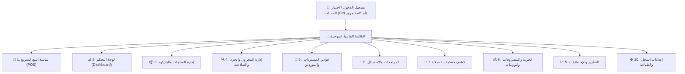

# 🎨 الجزء 10 — التصميم والهوية البصرية (UX/UI)

## نظام التصميم (Design System)، لوحة الألوان، الخطوط، وتجربة المستخدم للشاشات

---

## 1. فلسفة التصميم (Design Principles)

| المبدأ | التطبيق في النظام |
|--------|-------------------|
| **الأولوية للسرعة (Speed-First)** | شاشة البيع تعمل بالكامل عبر الكيبورد وقارئ الباركود دون الحاجة للمس الفأرة. التركيز التلقائي دائم على حقل المسح. |
| **أوفلاين 100% (Zero External Assets)** | جميع الخطوط والأيقونات مضمنة ومحملة محلياً (Offline WOFF2 & SVG)، لا طلبات عبر CDN أو إنترنت. |
| **هوية راقية تناسب مستحضرات التجميل** | ألوان هادئة ونظيفة (طراز Sage Green & Warm Cream) تمنح إحساساً بالأناقة والنظافة، مع تباين عالي ومريح للعين لساعات العمل الطويلة. |
| **تصميم عربي أصيل (RTL Native)** | الاتجاه من اليمين لليسار، محاذاة الأرقام والأسعار بشكل سليم، وخط عربي حديث ومتناسق. |
| **حماية من الأخطاء العرضية** | تعطيل الأزرار أثناء المعالجة (Debounce)، نوافذ تأكيد للعمليات الخطرة، ورسائل تنبيه عربية واضحة وبسيطة. |

---

## 2. لوحة الألوان المعتمدة (Color Palette)

مستوحاة مباشرة من الهوية المعتمدة للمشروع:

```
┌────────────────────────────────────────────────────────────────────────┐
│                        الألوان الأساسية للهوية                          │
├──────────────┬──────────────┬──────────────┬──────────────┬────────────┤
│   #2F4A3E    │   #4F6B5E    │   #E3EAE5    │   #F4F5F2    │  #FFFFFF   │
│  Deep Green  │  Sage Green  │  Mint Tint   │ Neutral BG   │ Card White │
│  (Brand Text)│(Primary BTN) │(Active Nav)  │  (App Body)  │  (Surface) │
└──────────────┴──────────────┴──────────────┴──────────────┴────────────┘
```

### جدول رموز الألوان واستخداماتها البرمجية:

| المتغير البرمجي | الكود اللوني (HEX) | الاستخدام |
|-----------------|-------------------|-----------|
| `--color-brand-deep` | `#2F4A3E` | هوية الشعار، العناوين البارزة، وحالة التحديد النشطة |
| `--color-primary` | `#4F6B5E` | أزرار الإجراءات الرئيسية (زر الدفع F4، الحفظ)، الروابط |
| `--color-primary-light` | `#E3EAE5` | خلفية العناصر المختارة في القائمة، خلفية أيقونة الهوية |
| `--bg-app` | `#F4F5F2` | الخلفية العامة للتطبيق (Warm Light Gray) |
| `--bg-surface` | `#FFFFFF` | البطاقات (`.card`)، القائمة الجانبية، الجداول |
| `--border-light` | `#E1E4E0` | فواصل الأقسام وخطوط ترويسة الجداول |
| `--border-input` | `#D5DAD6` | حدود حقول الإدخال والأزرار الثانوية (`#CBD2CD`) |
| `--text-main` | `#2B2F2D` | النصوص الأساسية، الأسعار، وأسماء المنتجات |
| `--text-muted` | `#6B726E` | التسميات التوضيحية (`.lb`)، التواريخ، وحالات الوردية |
| `--text-secondary` | `#4A514D` | النصوص الفرعية في الملخصات الجانبية |
| `--badge-warn-bg` | `#F6EBD3` | خلفية شارة الصلاحية القريبة والنواقص |
| `--badge-warn-text`| `#7A5A12` | نص شارة الصلاحية القريبة |
| `--color-danger` | `#5C2B2E` / `#FF8A80` | التنبيهات الخطرة وإلغاء العمليات |

---

## 3. الخطوط والطباعة (Typography)

### 3.1 الخط المعتمد:
- **`IBM Plex Sans Arabic`**
  - خط عصري يجمع بين الوضوح التقني العالي والجمال البصري.
  - أوزان الخط المستخدمة:
    - **Regular (400):** نصوص الجداول والمدخلات.
    - **Medium (500):** أزرار الإجراءات وعناوين الحقول.
    - **SemiBold (600):** إجمالي الفاتورة، عناوين الشاشات، وهوية المحل.

### 3.2 مقاسات الخطوط (Scale):
```css
--font-h1: 22px;        /* عناوين الصفحات الرئيسية */
--font-stat: 26px;      /* أرقام مؤشرات لوحة التحكم */
--font-total: 30px;     /* إجمالي الفاتورة الكبير بشاشة البيع */
--font-body: 15px;      /* سطور الجداول والمنتجات */
--font-sub: 14px;       /* عناصر القائمة الجانبية وحالة الوردية */
--font-caption: 13px;   /* التسميات التوضيحية واختصارات لوحة المفاتيح */
--font-badge: 12px;     /* الشارات وبادجات التنبيه */
```

---

## 4. مكونات نظام التصميم (Core UI Components)

```css
/* مقتطف من CSS الأساسي للمشروع */

/* البطاقة العامة */
.card {
  background: #ffffff;
  border: 1px solid #E1E4E0;
  border-radius: 12px;
}

/* حقل الإدخال */
.in {
  width: 100%;
  box-sizing: border-box;
  height: 44px;
  padding: 0 14px;
  border: 1px solid #D5DAD6;
  border-radius: 8px;
  font-family: inherit;
  background: #ffffff;
  color: #2B2F2D;
  transition: border-color 0.15s ease;
}
.in:focus {
  outline: none;
  border-color: #4F6B5E;
}

/* حقل الباركود الرئيسي بالـ POS */
.in-barcode {
  height: 52px;
  font-size: 16px;
  font-weight: 500;
}

/* الزر الأساسي (Primary CTA) */
.bt {
  height: 44px;
  border: 0;
  border-radius: 8px;
  background: #4F6B5E;
  color: #ffffff;
  font-family: inherit;
  font-weight: 500;
  cursor: pointer;
  width: 100%;
  transition: background 0.15s ease;
}
.bt:hover {
  background: #3F574C;
}

/* الزر الثانوي (Secondary Action) */
.bt2 {
  height: 44px;
  border: 1px solid #CBD2CD;
  border-radius: 8px;
  background: #ffffff;
  font-family: inherit;
  color: #2B2F2D;
  cursor: pointer;
  width: 100%;
}
.bt2:hover {
  background: #F4F5F2;
}

/* شارة التنبيه (Status Badge) */
.bd-warning {
  font-size: 12px;
  padding: 2px 10px;
  border-radius: 20px;
  background: #F6EBD3;
  color: #7A5A12;
  font-weight: 500;
}
```

---

## 5. خريطة الشاشات الرئيسية (Screen Hierarchy)



### 5.1 القائمة الجانبية (Navigation Sidebar)
- **العرض:** `220px`، خلفية بيضاء مع خط فاصل أيسر (`border-left: 1px solid #E1E4E0`).
- **الترويسة:** شارة دائرية للهوية وبجانبها `[اسم المحل]`.
- **الروابط:** قائمة عمودية بأيقونات بسيطة واسم الشاشة.
- **الحالة النشطة (`.nv.on`):** خلفية بلون النعناع الهادئ (`#E3EAE5`) ونص بلون الأخضر الداكن (`#2F4A3E`) بوزن SemiBold.
- **التذييل:** اسم المستخدم المسجل ورتبته (مثال: `أحمد · المالك`).

### 5.2 شاشة البيع (POS Interface):
- **تخطيط ثنائي الأعمدة (Split Screen Layout):**
  - **العمود الأيمن (منطقة العمل):**
    - حقل الباركود التلقائي (`F2`).
    - جدول المنتجات المفصل (الصنف، الكمية مع أزرار +/-، سعر الوحدة، الإجمالي، وزر حذف السطر).
  - **العمود الأيسر (منطقة الفاتورة والدفع - بعرض 340px):**
    - ملخص المبالغ: المجموع، الخصومات المطبقة، الضريبة (إن وجدت).
    - صندوق الإجمالي النهائي بخط ضخم (`30px`) وواضح جداً للزبون والبائع.
    - زر الدفع الفوري بلون الهوية الأخضر (`دفع F4`).
    - أزرار الخصم (`F8`) والتعليق (`F9`).
  - **الشريط السفلي (Hotkeys Legend):**
    - دليل دائم لاختصارات الكيبورد: `F2 بحث · F4 دفع · F6 عميل · F8 خصم · F9 تعليق · Esc إلغاء`.

### 5.3 شاشة لوحة التحكم (Dashboard):
- شبكة من 4 بطاقات إحصائية رئيسية (مبيعات اليوم، عدد الفواتير، صافي الربح التقديري، حالة الوردية).
- جداول سريعة للتنبيهات الحية:
  - جدول **"قاربت صلاحيتها"** بشارات المدة المتبقية (بعد 21 يوماً، بعد 45 يوماً).
  - جدول **"نواقص المخزون"** بالكميات المتبقية الحرجة.

---

## 6. إمكانية الوصول وسهولة الاستخدام (UX Guidelines)

1. **التعامل مع الشاشات اللمسية (Touchscreen Ready):**
   - جميع حقول الإدخال والأزرار بارتفاع لا يقل عن `44px` إلى `52px` لضمان سهولة النقر بالإصبع دون أخطاء.
2. **منع النقرات المزدوجة (Double-Click Prevention):**
   - الأزرار المالية (دفع، إغلاق وردية، حفظ تسوية) تصبح فوراً بحالة `disabled` ويظهر مؤشر تحميل فوري لحين اكتمال الـ IPC transaction.
3. **التغذية الصوتية (Audio Feedback):**
   - نغمة نجاح خفيفة وقصيرة (Beep) عند قراءة باركود صحيح.
   - نغمة تنبيه مميزة عند مسح باركود غير موجود أو منتج منتهي الصلاحية.
4. **رسائل الخطأ الصديقة للبائع:**
   - الابتعاد عن الرموز التقنية واللغة الإنجليزية في التنبيهات.
   - صياغة الرسائل بوضوح: *"المنتج منتهي الصلاحية بتاريخ 2026-09-01 ولا يمكن بيعه"* مع زر *"موافق"*.
