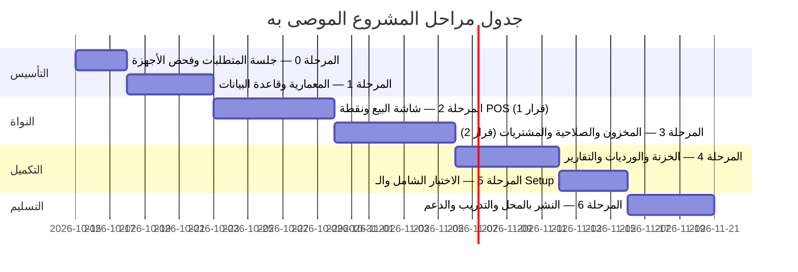

# 🚀 الجزء 11 — خطة التنفيذ والتسليم

## مراحل التطوير، المخرجات النهائية، مواصفات العتاد، وقائمة فحص التسليم (Checklist)

---

## 1. استراتيجية التطوير المرحلي (Iterative Delivery)

الهدف هو رؤية صاحب المحل للنظام وتجربته مبكراً للحصول على ملاحظات حقيقية على الكاونتر بدلاً من المفاجآت عند التسليم النهائي.

---

## 2. تفصيل مراحل التنفيذ

### المرحلة 0: جلسة الاكتشاف وفحص عتاد المحل
- **الهدف:** التأكد من بيئة التشغيل الفعلية داخل المحل.
- **المهام:**
  1. فحص جهاز الكمبيوتر (إصدار Windows، المعالج، الذاكرة، مساحة القرص).
  2. تجربة قارئ الباركود (هل يرسل مفتاح Enter بعد القراءة؟ هل يقرأ باركودات العبوات الصغيرة EAN-13 بنجاح؟).
  3. فحص طابعة الفواتير وتثبيت تعريفها التجريبي (Driver) واختبار أمر فتح الدرج.
  4. طرح قائمة الأسئلة الـ 16 المحددة بالوثيقة مع صاحب المحل واعتماد السياسات.

### المرحلة 1: البنية التحتية وقاعدة البيانات
- **الهدف:** بناء قاعدة صلبة ومستقرة بنظام "صفر أخطاء".
- **المخرجات:**
  - تهيئة مشروع Electron + React + TypeScript وتكوين IPC الآمن.
  - إنشاء قاعدة بيانات SQLite وتفعيل PRAGMAs (وضع WAL، synchronous = FULL).
  - كتابة الـ Migrations والـ Triggers لحركات المخزون المقفلة (Append-only).
  - بناء دوال اختبارات الوحدة (Unit Tests) للعمليات الحسابية والمالية.

### المرحلة 2: شاشة البيع (POS) — نقطة القرار الأولى 🛑
- **الهدف:** تسليم نموذج يعمل لشاشة البيع ليقوم البائع بتجربته بالسكانر الفعلي.
- **المخرجات:**
  - شاشة POS متكاملة تقبل مسح الباركود السريع.
  - سلة البيع، الخصومات المسموحة، طرق الدفع المختلفة.
  - طباعة إيصال تجريبي على طابعة 80mm وفتح درج النقدية.
  - **نقطة قرار العميل:** يرى صاحب المحل الشاشة ويجرب إيقاع البيع وسرعة الاستجابة ويعتمد التصميم.

### المرحلة 3: المخزون والصلاحية والمشتريات — نقطة القرار الثانية 🛑
- **الهدف:** ضبط حركة البضاعة بالدفعات وتتبع الصلاحية بدقة.
- **المخرجات:**
  - استيراد أصناف المحل من ملف Excel الأولي وتوليد الباركودات الداخلية للقطع الناقصة.
  - تطبيق منطق FEFO التلقائي ومنع بيع المنتهي.
  - تسجيل فواتير المشتريات وتحديث حسابات الموردين.
  - شاشة الجرد الدوري بالمسح ومقارنة الفروقات.
  - **نقطة قرار العميل:** مطابقة طريقة تتبع الصلاحية وتنبيهات النواقص مع أسلوب إدارة المحل.

### المرحلة 4: الخزنة والورديات والتقارير والإعدادات
- **الهدف:** التحكم المالي الشامل ولوحة القيادة.
- **المخرجات:**
  - دورة الوردية الكاملة وطباعة تقرير Z-Report بعد العد الأعمى.
  - تسجيل المصروفات النثرية وحركات الخزنة الرئيسية.
  - شاشات التقارير وتصدير Excel/PDF.
  - شاشة الإعدادات العامة لتهيئة اسم المحل والشعار والسياسات.

### المرحلة 5: الاختبارات النهائية وبناء ملف التثبيت
- **الهدف:** إنتاج نسخة نهائية مستقرة خالية من الثغرات.
- **المخرجات:**
  - اختبار سيناريوهات انقطاع الكهرباء الفجائي (Crash Test) أثناء عمليات البيع.
  - إنشاء ملف التثبيت المستقل `setup.exe` عبر `electron-builder`.
  - تجربة التثبيت على جهاز كمبيوتر جديد تماماً غير متصل بالإنترنت.

### المرحلة 6: النشر في المحل والتدريب العملي
- **الهدف:** الانطلاق التجريبي ثم الفعلي.
- **المخرجات:**
  - تثبيت البرنامج على جهاز المحل وتوصيل الملحقات.
  - إدخال الأرصدة الافتتاحية للمخزون والنقدية.
  - تدريب الكاشير والمدير عملياً لمدة ساعتين على الشاشات والاختصارات.
  - مرافقة المحل أثناء أول يوم عمل حقيقي.

---

## 3. قائمة مواصفات العتاد الموصى بها (Hardware Specs)

| المكوّن | الحد الأدنى المقبول | المواصفات الموصى بها لتجربة ممتازة | ملاحظات |
|---------|---------------------|-----------------------------------|---------|
| **نظام التشغيل** | Windows 10 (64-bit) | Windows 10 / 11 Pro (64-bit) | التأكد من سلامة النظام وخلوه من الفيروسات |
| **المعالج (CPU)** | Intel Core i3 الجيل 6 أو ما يعادله | Intel Core i5 أو AMD Ryzen 5 | لضمان فتح النوافذ والتقارير في أجزاء من الثانية |
| **الذاكرة (RAM)** | 4 GB | 8 GB أو أكثر | تمنح Electron وSQLite سلاسة كاملة |
| **القرص الصلب** | HDD عادي | **SSD (Solid State Drive)** بمساحة 128GB+ | **ضروري جداً** لسرعة الـ WAL وحماية البيانات من التلف |
| **مزود طاقة طوارئ (UPS)** | اختياري | **UPS صغير (650VA - 800VA)** | **أهم استثمار للمحل:** يمنع تلف القرص عند قطع الكهرباء |
| **قارئ الباركود (Scanner)** | سكانر USB ليزر 1D | **سكانر USB متعدد الاتجاهات (1D + 2D/QR)** | لقراءة الباركودات حتى لو كانت مخدوشة أو من شاشات الموبايل |
| **طابعة الإيصالات** | طابعة حرارية 58mm | **طابعة حرارية 80mm USB مع قاطع آلي (Auto-cutter)** | سرعة طباعة عالية ولا تحتاج حبر إطلاقاً |
| **درج النقدية (Cash Drawer)** | يدوي بمفتاح | **درج نقدية إلكتروني RJ11 يتصل بالطابعة** | يفتح تلقائياً عند تأكيد البيع النقدي فقط |
| **وسيط النسخ الاحتياطي** | لا يوجد | **فلاشة USB 3.0 (32GB+) مخصصة للنسخ الاحتياطي** | تبقى محفوظة بأمان خارج المحل أسبوعياً |

---

## 4. المخرجات وحقيبة التسليم النهائية (Final Deliverables)

1. 💿 **ملف التثبيت الذاتي (`setup.exe`):** بنقرة واحدة، يقوم بتثبيت البرنامج ومكوناته وقاعدة البيانات محلياً.
2. 📖 **دليل المستخدم المصور (PDF باللغة العربية):** شرح مبسط لكل شاشة مع صور توضيحية وقائمة الاختصارات.
3. 🎥 **فيديو تدريبي موجز (10-15 دقيقة):** مسجل للكاشير يشرح كيفية فتح الوردية، مسح الفاتورة، تطبيق الخصم، إتمام الدفع، وعمل الإغلاق Z-Report.
4. ⚙️ **دليل الصيانة للمطور (Developer README):** توثيق المعمارية، كيفية التعديل، تشغيل الـ Migrations، وعمل الإصدارات.
5. 🧪 **بيانات تجريبية جاهزة (Seed Data):** تشمل أصناف تجميل وموردين وعملاء وهميين لتدريب الكاشير قبل بدء العمل الفعلي.
6. 🚑 **دليل الاسترجاع الطارئ (Disaster Recovery Runbook):** ورقة واحدة مطبوعة توضع في درج المحل تشرح ماذا يفعل صاحب المحل في حال تعطل الجهاز.

---

## 5. مصفوفة إدارة المخاطر وتداركها

| الخطر المحتمل | مستوى الأثر | خطة التدارك والحل البرمجي |
|---------------|:-----------:|---------------------------|
| **انقطاع الكهرباء أثناء حفظ الفاتورة** | مرتفع | تفعيل `WAL mode` و `synchronous = FULL` و `Transactions` لضمان عدم حفظ نصف العملية + التوصية بجهاز UPS. |
| **بطء قراءة الباركود أو عدم قراءته** | متوسط | توفير زر بحث فوري بالاسم بالضغط على `F2` دون الحاجة لاستخدام الماوس، وإمكانية توليد وطباعة باركودات داخلية. |
| **تلف جهاز الكمبيوتر بالكامل أو القرص الصلب** | كارثي | نسخ احتياطي يومي بـ `VACUUM INTO`، وإلزام المالك بنسخ أسبوعي على فلاشة USB خارجية تمكنه من استرجاع النظام بـ 5 دقائق. |
| **فروقات وعجز بين نقدية الدرج والنظام** | متوسط | تقنية العد الأعمى (Blind Count) في إغلاق الوردية + منع تعديل أو حذف أي حركة نقدية مسجلة. |
| **تثبيت ويندوز قديم غير متوافق** | متوسط | فحص الجهاز مسبقاً في المرحلة 0 وضمان توافق إصدار Node/Electron مع بيئة ويندوز المستهدفة. |

---

## 6. قائمة فحص التسليم المسبق (Pre-Launch Checklist)

يتم فحص هذه النقاط بنداً بنداً مع صاحب المحل قبل توقيع محضر التسليم:

### أ. فحص الأجهزة والتوصيلات:
- [ ] قارئ الباركود يقرأ بسرعة ويرسل `Enter` تلقائياً.
- [ ] طابعة الفواتير تطبع بوضوح وتدعم الحروف العربية دون تقطيع بالكلمات.
- [ ] درج النقدية يفتح تلقائياً عند طباعة الفاتورة النقدية ويبقى مغلقاً في الفواتير الآجلة/الفيزا.
- [ ] الشاشة تعرض الألوان والخطوط بوضوح مريح للعين.

### ب. فحص دورة البيع والمخزون:
- [ ] مسح باركود صنف يضيفه للسلة خلال أقل من 0.5 ثانية.
- [ ] تكرار مسح نفس الصنف يزيد الكمية بمقدار 1.
- [ ] تجربة بيع صنف منتهي الصلاحية والتأكد من رفض النظام إضافته.
- [ ] خصم الكميات من الدفعة الأقدم صلاحية بنظام (FEFO) تلقائياً.
- [ ] تجربة تعليق الفاتورة (Hold) واسترجاعها بنجاح.

### ج. فحص الخزنة والأمان:
- [ ] فتح وردية برصيد 500 جنيه يظهر بشكل صحيح بالرصيد الافتتاحي.
- [ ] تسجيل مصروف نثري يخصم فوراً من كاش الوردية.
- [ ] إجراء إغلاق وردية بعدّ فعلي ومطابقة الفارق وطباعة Z-Report بنجاح.
- [ ] تجربة تسجيل دخول الكاشير برمز PIN، وتأكيد حجب أسعار التكلفة وتقارير الأرباح عنه.

### د. فحص النسخ الاحتياطي:
- [ ] تنفيذ أمر النسخ الاحتياطي والتأكد من توليد ملف `.db` صالح بمجلد النسخ.
- [ ] تجربة استرجاع قاعدة البيانات والتأكد من ظهور كافة العمليات والبيانات السابقة سليمة 100%.

---

## 7. خطة الدعم الفني بعد التسليم

- **فترة الضمان والمراقبة المكثفة:** أسبوعان من المتابعة اليومية والدعم الفوري لحل أي استفسارات أو ملاحظات تشغيلية.
- **قناة الدعم المعتمدة:** خط واتساب مباشر للمحل مع إمكانية الدعم عن بعد عبر أداة (AnyDesk / RustDesk) عند توفر إنترنت طارئ.
- **ترقيات البرامج والتحديثات:** في حال طلب مميزات جديدة مستقبلاً، يتم توفير ملف تحديث بسيط يقوم بتحديث البرنامج وتنفيذ الـ Migrations دون أي تأثير على بيانات المبيعات أو المخزون القائم.
